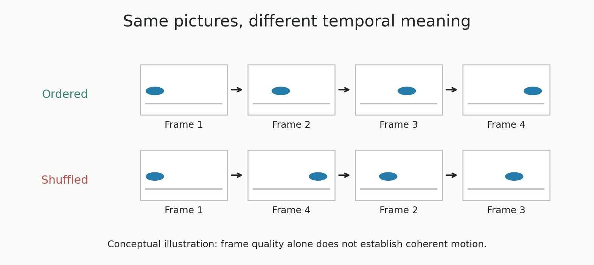
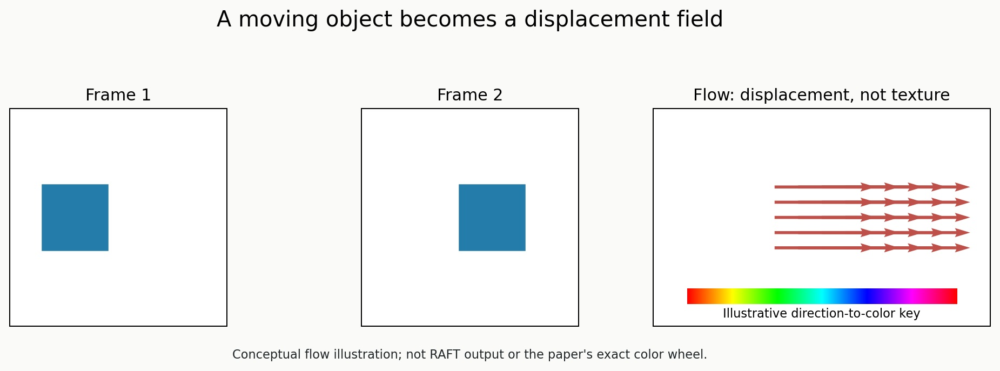
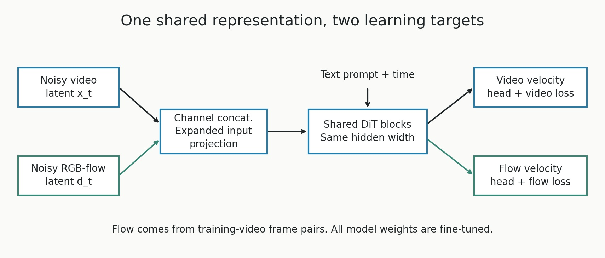
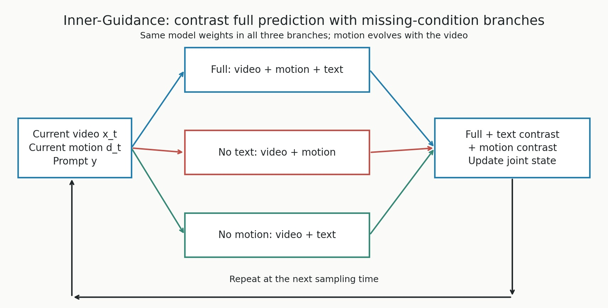
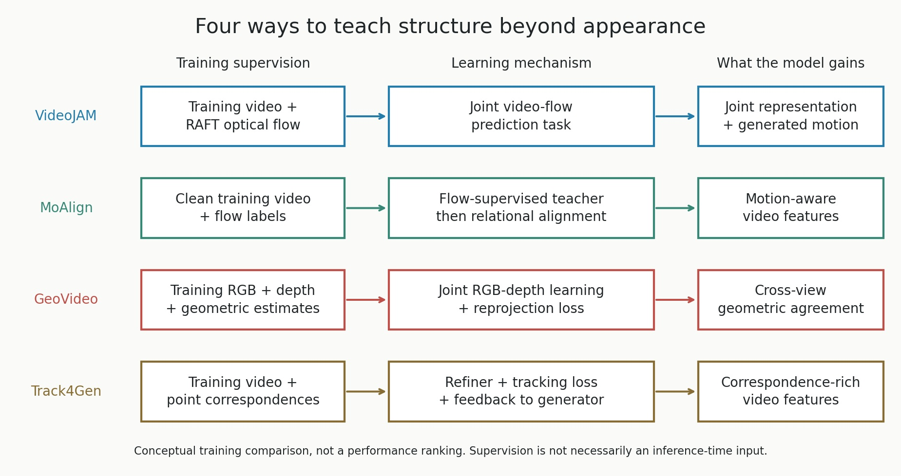

# VideoJAM: Joint Appearance-Motion Representations for Enhanced Motion Generation in Video Models

**Paper:** Hila Chefer et al., [VideoJAM, arXiv v2](https://arxiv.org/html/2502.02492v2), May 2025. [Project page and video examples](https://hila-chefer.github.io/videojam-paper.github.io/).

**The idea in one sentence:** teach a video generator to predict both appearance and motion through one shared representation, then use its evolving motion prediction to guide the video during sampling.

A sharp image of a person running is not enough: the next frames must show a believable sequence of strides. VideoJAM tries to make that temporal structure something the model explicitly learns, rather than hoping it emerges from an appearance-based objective alone.

## Table of Contents

- [1. Why good-looking frames can still make a bad video](#1-why-good-looking-frames-can-still-make-a-bad-video)
  - [1.1 The frame-shuffling experiment](#11-the-frame-shuffling-experiment)
- [2. The central idea: appearance and motion share a representation](#2-the-central-idea-appearance-and-motion-share-a-representation)
- [3. How motion becomes a learnable video](#3-how-motion-becomes-a-learnable-video)
  - [3.1 Optical flow: where each visible point moves](#31-optical-flow-where-each-visible-point-moves)
  - [3.2 Why encode flow as RGB](#32-why-encode-flow-as-rgb)
- [4. Setup and flow-matching basics](#4-setup-and-flow-matching-basics)
- [5. Joint training: one backbone, two targets](#5-joint-training-one-backbone-two-targets)
  - [5.1 The architectural change](#51-the-architectural-change)
  - [5.2 The joint objective](#52-the-joint-objective)
  - [5.3 Training for missing conditions](#53-training-for-missing-conditions)
- [6. Inner-Guidance: use the evolving motion prediction](#6-inner-guidance-use-the-evolving-motion-prediction)
  - [6.1 Three predictions from the same model](#61-three-predictions-from-the-same-model)
  - [6.2 The sampling loop and guidance schedule](#62-the-sampling-loop-and-guidance-schedule)
  - [6.3 Why not just reuse ordinary compositional guidance](#63-why-not-just-reuse-ordinary-compositional-guidance)
- [7. What the experiments actually establish](#7-what-the-experiments-actually-establish)
  - [7.1 The strongest comparison: the same base model](#71-the-strongest-comparison-the-same-base-model)
  - [7.2 More motion is not the same as better motion](#72-more-motion-is-not-the-same-as-better-motion)
  - [7.3 What the ablations tell us](#73-what-the-ablations-tell-us)
- [8. Implementation costs and limitations](#8-implementation-costs-and-limitations)
- [9. Takeaways and connections](#9-takeaways-and-connections)
- [10. Related papers: motion, geometry, and correspondence](#10-related-papers-motion-geometry-and-correspondence)
  - [10.1 MoAlign: teach motion through feature relationships](#101-moalign-teach-motion-through-feature-relationships)
  - [10.2 GeoVideo: make generated depth agree across views](#102-geovideo-make-generated-depth-agree-across-views)
  - [10.3 Track4Gen: preserve identity by learning to track](#103-track4gen-preserve-identity-by-learning-to-track)
  - [10.4 Comparing the four approaches](#104-comparing-the-four-approaches)
- [11. Sources and figure reproduction](#11-sources-and-figure-reproduction)

## 1. Why good-looking frames can still make a bad video

Imagine a clip of a ball moving steadily from left to right. Every frame looks sensible on its own. Now keep those exact frames but scramble their order: the ball jumps forward, backward, and forward again. The collection of attractive images is unchanged; the motion is not.



This is the distinction VideoJAM targets. A standard video generator is trained to predict a video, noise, or a denoising velocity using a squared-error objective. Those targets contain temporal information, but the objective does not necessarily give motion mistakes a strong enough learning signal. Color, texture, and other appearance differences can dominate the error, especially when the moving subject occupies a small part of the scene.

**This is an empirical bias, not a mathematical claim that pixel loss is always invariant to frame order.** A spatiotemporal model can learn motion from a pixel-based target. The paper's argument is that its tested models underuse that information at important sampling times, and an explicit motion target helps.

### 1.1 The frame-shuffling experiment

The authors take 35,000 training videos, add noise at randomly selected sampling times, and compare the loss on an original video with the loss after randomly permuting its frames. They aggregate the change in loss by timestep.

For their vanilla DiT-4B model, the measured loss is nearly unchanged through approximately the first 60 of 100 generation steps. Their VideoJAM-fine-tuned model is much more sensitive to the same temporal perturbation. Separately, an experiment that restarts generation from partially noised videos suggests that coarse motion and structure become established during this earlier part of sampling, while appearance continues to refine later.

The connection matters: **the base model is relatively insensitive to temporal disruption during a phase that helps decide motion.** VideoJAM adds a target that makes temporal structure harder to ignore. These experiments support the motivation on the tested model; they do not prove that the objective is the only source of motion failures in every video generator.

## 2. The central idea: appearance and motion share a representation

Suppose the prompt is "a basketball spinning on a fingertip." Appearance describes the ball, hand, lighting, and surface texture. Motion describes the ball's rotation and the relative stability of its center. The two descriptions refer to the same evolving scene, so learning them independently would throw away useful relationships.

VideoJAM instead asks one backbone to produce both descriptions:

- The video branch must explain what the scene looks like.
- The motion branch must explain how visible points move between adjacent frames.
- Both predictions must be recoverable from the same hidden representation.

This is **joint prediction**, not a pipeline that first generates a complete motion plan and then renders it. Motion and appearance evolve together during sampling. It is also not simply extra text conditioning: motion is a supervised training target and a generated state at inference.

There are two complementary changes. Joint training teaches the motion prior; Inner-Guidance encourages the sampler to use it. Merely learning a useful auxiliary signal does not guarantee that generation will make full use of that signal.

## 3. How motion becomes a learnable video

### 3.1 Optical flow: where each visible point moves

**Optical flow** is a dense field of estimated two-dimensional displacements between two frames. At each image position, it describes how far the corresponding visible point moves horizontally and vertically. It does not describe texture, object identity, or a complete three-dimensional trajectory.



For the moving square above, the appearance changes position, while its flow is a group of approximately rightward arrows. A rotating object produces different displacement directions across its visible surface. This turns motion into a spatially organized prediction target rather than a vague instruction to "be temporally coherent."

During fine-tuning, the authors use **RAFT**, an optical-flow estimator, to obtain flow from the existing training videos. They do not collect an additional video dataset, but they do add derived motion supervision. At inference, the motion latent is generated by VideoJAM itself; RAFT is not the source of a new motion condition at every sampling step.

### 3.2 Why encode flow as RGB

The backbone already operates on video latents produced by a **temporal autoencoder**, which compresses space and time. VideoJAM converts the flow field into an RGB video so it can use that same autoencoder instead of training a separate motion encoder.

To describe the encoding without overloading image coordinates, let $a$ and $b$ be a flow vector's horizontal and vertical displacement in pixels. Let $H$ and $W$ be image height and width, $m$ the normalized motion magnitude, $\alpha$ the direction angle, and $\sigma=0.15$ the paper's normalization coefficient:

$$
m=\min\left(1,\frac{\sqrt{a^2+b^2}}{\sigma\sqrt{H^2+W^2}}\right),
\qquad
\alpha=\mathrm{atan2}(b,a).
$$

The numerator is displacement length. The image diagonal in the denominator makes that length relative to image size; multiplying the diagonal by $0.15$ makes modest movements more distinguishable than normalizing by the entire diagonal. The minimum clips the normalized magnitude at one. The angle determines color, and magnitude determines how strongly the motion color is expressed relative to the background.

The exact color convention is an encoding choice, not the scientific contribution. What matters is preserving direction and relative magnitude in an RGB-compatible signal. The diagram is illustrative, not the paper's exact color wheel. The v2 text uses ambiguous "opacity" language; the useful interpretation is that the representation must make motion strength distinguishable, rather than treating its wording as a precise implementation specification.

The trade-off is practical: reuse of the video autoencoder is convenient, but an RGB flow representation is not a lossless, physics-aware description of movement. In particular, very small displacements can become hard to represent.

## 4. Setup and flow-matching basics

VideoJAM's experiments use a **Diffusion Transformer (DiT)** trained with **flow matching**. Flow matching learns a velocity field that transports a noisy sample toward a data sample. That denoising velocity is different from optical flow: one moves a sample through latent space during generation; the other describes visible displacement across video frames.

For the equations below:

- $x_1$: a clean training video's autoencoder latent, not raw RGB pixels.
- $x_0$: an independent standard Gaussian noise latent with the same shape.
- $t\in[0,1]$: the interpolation time; zero is noise and one is clean data.
- $x_t$: the intermediate noisy video latent.
- $y$: the text-prompt condition.
- $u^x_\theta$: the model's predicted video denoising velocity, with trainable weights $\theta$.
- $v^x$: the target video denoising velocity.
- $\mathbb{E}$: an average over sampled training videos, prompts, noises, and times.
- $\|\cdot\|_2^2$: the sum of squared differences across the latent entries.

The straight interpolation path is

$$
x_t=t x_1+(1-t)x_0.
$$

The clean-video weight grows with time, while the noise weight shrinks. This gives the model examples along a simple noise-to-video path. It is the experimental setup used here, not a claim that all diffusion models use this convention.

Differentiate that path with respect to time to obtain its training velocity:

$$
v^x=\frac{d x_t}{d t}=x_1-x_0.
$$

The difference between the clean latent and its sampled noise is the direction of the straight path. The network must infer that direction from the noisy intermediate sample, time, and prompt; it is not given the clean target during generation.

The ordinary appearance-only training objective is therefore

$$
\mathcal{L}_{\mathrm{video}}
=\mathbb{E}\left[\|u^x_\theta(x_t,y,t)-v^x\|_2^2\right].
$$

Here $\mathcal{L}_{\mathrm{video}}$ is the average video velocity-prediction error. The squared difference asks the network to predict the correct transport direction. The concern from Section 1 is not that motion is absent from this target, but that appearance can dominate what the model learns from it.

## 5. Joint training: one backbone, two targets

### 5.1 The architectural change



Let $d_1$ be the autoencoder latent of the clean RGB optical-flow video, $d_0$ its independent Gaussian noise, and $d_t$ its noisy intermediate latent. Apply the same interpolation rule as for appearance:

$$
d_t=t d_1+(1-t)d_0,
\qquad
v^d=d_1-d_0.
$$

The motion stream is noised at the same interpolation time as the appearance stream. Its target $v^d$ is the denoising velocity of the **encoded flow video**, not the raw optical-flow displacement vectors. This distinction prevents the two different meanings of "flow" from getting mixed up.

The model concatenates $x_t$ and $d_t$ **along the channel dimension**, then projects the combined input into the DiT's existing hidden width. The Transformer blocks process a single shared representation. Separate linear output projections recover the video velocity and motion velocity.

The input projection's added motion rows are initialized to zero, so initially the pretrained model ignores the new input channels. A new output projection provides the motion prediction. Importantly, **the Transformer hidden width and token sequence are not doubled**: the added information enters through channels, not a second full sequence of motion tokens.

The paper describes this as a very small architectural adaptation involving the input and output projections. It does **not** mean that only those projections are trained. All network weights are jointly fine-tuned so the shared representation can adapt to the new objective.

### 5.2 The joint objective

Let $u^x_\theta(x_t,d_t,y,t)$ and $u^d_\theta(x_t,d_t,y,t)$ be the joint model's video and motion velocity predictions, respectively. For readability, $\theta$ now denotes all fine-tuned weights, including the expanded projections. The concatenated squared-error objective in the paper can be written as

$$
\mathcal{L}_{\mathrm{joint}}
=\mathbb{E}\left[
\|u^x_\theta(x_t,d_t,y,t)-v^x\|_2^2
+\|u^d_\theta(x_t,d_t,y,t)-v^d\|_2^2
\right].
$$

Here $\mathcal{L}_{\mathrm{joint}}$ is the combined training loss. The first term retains the appearance task; the second supplies an explicit motion task. This is simply the squared error on a concatenation split into its two parts, not a new extra weighting scheme. Both errors train the shared backbone, so it must organize its features in a way that supports both kinds of prediction.

**Why this can help:** a representation useful for reconstructing a ball's texture may ignore its rotation. A representation that must also predict its motion has an additional reason to capture the rotating surface structure. This is the intuition behind the auxiliary target, not a guarantee that the two predictions will always be perfectly consistent.

### 5.3 Training for missing conditions

Guidance requires comparisons with less-conditioned predictions, so the model needs to learn those cases during training. The authors randomly drop text in 30% of training steps and optical flow in 20% of steps. Dropped flow is represented by zeros. When flow is dropped, the loss is computed on appearance only, returning to the appearance-only training task.

This avoids asking the model at inference to handle missing conditions it never saw during training. It also prepares the branches used by Inner-Guidance: full conditioning, no text, and no motion. These branches are evaluations of the same trained network, not separate models.

## 6. Inner-Guidance: use the evolving motion prediction

Joint training equips the model with a motion prior. Inner-Guidance changes sampling so generation makes stronger use of that prior. Its motion signal is **internal and evolving**: the noisy motion latent is part of the state being generated alongside the video.



### 6.1 Three predictions from the same model

For a compact expression, let $U_\theta$ denote the joint output vector containing both velocity predictions. At the current video state, motion state, prompt, and time, define

$$
\begin{aligned}
U_{\mathrm{full}}&=U_\theta(x_t,d_t,y,t),\\
U_{\mathrm{no\ text}}&=U_\theta(x_t,d_t,\emptyset,t),\\
U_{\mathrm{no\ motion}}&=U_\theta(x_t,0,y,t).
\end{aligned}
$$

The first output has both text and motion available. The second removes only text; $\emptyset$ denotes the dropped text condition. The third removes motion using the zero-input convention from training. These controlled contrasts let the sampler isolate the effect of each condition while retaining the other one.

Let $w_{\mathrm{text}}$ and $w_{\mathrm{motion}}$ be the text and motion guidance strengths, and $\widetilde U$ the guided joint velocity. The paper's practical combination can be rearranged into

$$
\widetilde U
=U_{\mathrm{full}}
+w_{\mathrm{text}}(U_{\mathrm{full}}-U_{\mathrm{no\ text}})
+w_{\mathrm{motion}}(U_{\mathrm{full}}-U_{\mathrm{no\ motion}}).
$$

Start with the fully conditioned prediction. The first difference emphasizes what text changes when motion is already present. The second emphasizes what motion changes when text is already present. Positive weights extrapolate along these contrasts; they are not averaging weights. The authors use $w_{\mathrm{text}}=5$ and $w_{\mathrm{motion}}=3$ by default.

This form explains the mechanism without a long probability derivation. It is related to classifier-free guidance, but the motion condition is not an externally fixed reference: it evolves as part of generation. See [classifier-free-guidance.md](classifier-free-guidance.md) for the basic conditional-minus-unconditional intuition.

The no-motion branch is trained with appearance-only supervision when flow is absent. Its role should therefore be understood as providing an appearance-only contrast, not as an independently trustworthy motion generator.

### 6.2 The sampling loop and guidance schedule

At a high level, sampling proceeds as follows:

1. Initialize video and motion latents from Gaussian noise.
2. Evaluate the three branches at the current state and time.
3. Combine their predictions using Inner-Guidance.
4. Advance the video and motion states along the sampling trajectory.
5. Repeat, then decode the final video latent into RGB frames.

The paper uses 100 sampling steps with a linear-quadratic time schedule. **Motion guidance is applied only during the first 50 steps**, when coarse motion is being established; text guidance remains part of generation. This timing follows the motivation experiments, rather than spending extra motion-guidance computation uniformly throughout refinement.

An illustrative Euler update makes the joint-state idea explicit. Let $\Delta t$ be a small increment in interpolation time, and let $\widetilde u^x$ and $\widetilde u^d$ be the appearance and motion components of $\widetilde U$:

$$
x_{t+\Delta t}\approx x_t+\Delta t\,\widetilde u^x,
\qquad
d_{t+\Delta t}\approx d_t+\Delta t\,\widetilde u^d.
$$

Both states advance using the predictions at the current joint state. The updated motion latent is then available at the next time, so the guidance signal evolves with the video. This is a teaching illustration of velocity integration, not a claim that the appendix specifies this exact numerical solver or a uniform time schedule.

Do not confuse this loop with "decode each intermediate video, run RAFT, and feed that measured flow back in." VideoJAM co-generates the motion representation in latent space. It also does not require the user to provide an optical-flow video or a prescribed motion trajectory.

### 6.3 Why not just reuse ordinary compositional guidance

The paper motivates Inner-Guidance by reweighting the joint sampling distribution to favor prompt compatibility and compatibility between appearance and the generated motion. It then expresses that reweighting through the three network predictions above.

Its distinction from the InstructPix2Pix-style composition considered in Appendix A is that motion is generated by the model and depends on text, rather than being a fixed external condition. The resulting practical contrast compares the fully conditioned prediction with each missing-condition branch. The tested InstructPix2Pix alternative uses a different sequence of contrasts and performs worse in their ablation.

**A notation caution:** v2 writes derivatives with respect to model weights in its score discussion. A conventional diffusion score is a derivative with respect to the sample, not a parameter gradient. The note therefore presents the operational prediction formula, rather than interpreting those printed derivatives as a backpropagation procedure at inference. The appendix's independence argument should likewise be read as the authors' motivation, not as a general proof that all multi-condition guidance is invalid for dependent conditions.

## 7. What the experiments actually establish

The authors fine-tune 4B- and 30B-parameter internal DiT models on approximately 3 million samples from their existing training set. Their base models were pretrained on roughly 100 million videos. The fine-tuning uses 256-by-256 videos, 128 frames at 24 frames per second, giving approximately five-second clips.

**VideoJAM-bench** contains 128 prompts selected to probe basic motion, complex motion, rotation, and physical interactions. Prompts originate from a held-out set and are refined using an LLM. This is a deliberately motion-focused benchmark, not a representative sample of all possible text-to-video requests.

Human evaluation uses pairwise choices for motion, overall quality, and text faithfulness, with five raters per comparison. Automatic evaluation uses VBench. The additional Movie Gen evaluation uses its **high-motion subset**, rather than the entire benchmark indiscriminately.

### 7.1 The strongest comparison: the same base model

The most informative comparison keeps the base architecture and pretraining fixed and applies VideoJAM fine-tuning and sampling. On VideoJAM-bench:

| Human preference for VideoJAM over its base model | 4B | 30B |
|---|---:|---:|
| Motion | 82.0% | 72.7% |
| Overall quality | 77.3% | 74.2% |
| Text faithfulness | 71.1% | 71.9% |

These are pairwise preference percentages, **not motion accuracy**. They support a substantial improvement on this benchmark. They also suggest that better motion can improve perceived video quality without explicitly optimizing a separate perceptual-quality objective. The comparison measures the complete fine-tuning-and-sampling recipe; it is not a perfectly compute-matched control for every possible alternative fine-tuning objective.

The reported motion preferences for VideoJAM-30B over Sora, Kling 1.5, and Runway Gen3 are 68.5%, 63.8%, and 77.3%, respectively. Those are comparisons to the specific versions tested in the paper, not a claim about current products. Baselines are resized to 256 resolution for evaluation, but their training data, architectures, and native generation resolutions differ. Matching the display resolution does not remove those differences.

Also, the quality preference over Kling is 45.9%: the paper does **not** establish a universal win in visual quality against every proprietary baseline.

### 7.2 More motion is not the same as better motion

A nearly static clip can look very smooth. A chaotic clip can contain abundant movement. Neither necessarily satisfies a prompt asking for meaningful, coherent action, so motion evaluation must consider both activity and temporal quality.

The paper's aggregate motion score combines VBench **motion smoothness** and **dynamic degree**, which estimates the amount of movement. The 4B comparison makes the trade-off clear:

| VBench component on VideoJAM-bench | Base DiT-4B | VideoJAM-4B |
|---|---:|---:|
| Motion smoothness | 99.3 | 98.8 |
| Dynamic degree | 38.3 | 87.5 |

VideoJAM does not improve every individual score: smoothness declines slightly while generated activity rises substantially. The intended improvement is **more meaningful movement without losing much smoothness**, consistent with human motion preferences. Neither component alone verifies physical correctness, correct contact, or a fully successful action.

### 7.3 What the ablations tell us

The ablations use the 4B model and report pairwise motion preference for the full VideoJAM method over each variant:

| Removed or changed component | Preference for full VideoJAM | Interpretation |
|---|---:|---|
| Text guidance | 63.3% | Prompt-related steering still matters. |
| Inner-Guidance motion term | 66.2% | Learning motion is not the whole story; steering helps. |
| Optical-flow input at inference | 80.2% | Keeping the evolving motion state is especially important. |
| Replace Inner-Guidance with IP2P guidance | 78.1% | The choice of guidance contrasts matters in this setup. |

Dropping optical flow here is an **inference ablation of an already fine-tuned model**, not a clean training ablation that removes the auxiliary motion loss. The base-model comparison removes the entire VideoJAM recipe. Distinguishing these interventions prevents attributing every gain to the training loss alone.

The narrative in Section 5.3 appears to swap the text and motion guidance weight labels. Here the interpretation follows the explicit guidance equation and the named rows in Table 3.

## 8. Implementation costs and limitations

**Small architectural change does not mean cheap training in absolute terms.** The appendix reports 32 A100 GPUs for 50,000 fine-tuning iterations of the 4B model, and 256 A100 GPUs for 35,000 iterations of the 30B model, with a fixed learning rate of $5\times10^{-6}$. It also requires optical-flow estimation for training supervision. This is a relatively modest adaptation of a large pretrained generator, not a lightweight consumer-hardware experiment.

The same autoencoder compresses space by a factor of eight along each spatial axis and time by a factor of eight. The Transformer uses patches of one latent time position by two-by-two latent spatial positions. These details explain why both signals must remain spatially and temporally aligned after encoding.

Inner-Guidance evaluates three prediction branches during its motion-guided phase; the authors batch those evaluations. Batching can improve utilization, but it does not make extra predictions free. The paper does not provide a universal runtime overhead that can be applied to every backbone.

The main limitations are:

- **Small or distant moving subjects:** their displacement relative to image size is tiny. Low training resolution and the RGB flow encoding can weaken the available motion signal.
- **Complex physical interactions:** optical flow describes visible movement, not forces, contact constraints, or conservation laws. A ball can change direction without a convincing foot-to-ball contact, even if its trajectory looks smooth.
- **Imperfect motion supervision:** an estimated flow field is not ground-truth three-dimensional motion; occlusions and difficult visual regions can complicate estimation. This is a general limitation of the chosen representation, not a separately quantified VideoJAM result.
- **Limited generality of the evidence:** the method is designed to be adaptable, but the reported experiments use specific internal DiT models and data. They do not establish identical gains for every video architecture.

The project page's higher-resolution visualizations additionally use a trained spatial super-resolution model. The quantitative experiments are performed at the lower 256 resolution. Do not mistake those presentation examples for the native resolution of the evaluated generator.

## 9. Takeaways and connections

**The objective decides what the model has an incentive to notice.** If appearance dominates the learning signal, adding more parameters or videos may not be the only useful intervention. VideoJAM makes motion an explicit prediction task.

**Joint prediction is stronger than merely displaying an auxiliary output.** Both tasks shape a shared hidden representation, and inference continues to use the generated motion state. The useful pattern is to learn a structured auxiliary signal and then build sampling around it.

**Learned motion is not learned physics by definition.** Optical flow can improve action coherence and some interactions, but no mechanism here enforces a physical simulator's rules.

Connections to nearby notes:

- [ddpm_ddim_flow_score.md](ddpm_ddim_flow_score.md): background on denoising, flow matching, and score/velocity parameterizations.
- [classifier-free-guidance.md](classifier-free-guidance.md): the prediction-contrast intuition behind guidance.
- [diffusion-forcing.md](diffusion-forcing.md): a different intervention in video generation, centered on per-frame noise levels and sampling flexibility rather than an explicit appearance-motion target.

**A compact explanation to remember:** "VideoJAM fine-tunes a video model to co-generate appearance and optical flow through one shared representation. During sampling, it contrasts full predictions with missing-text and missing-motion predictions, using its own evolving motion state to strengthen coherent movement."

## 10. Related papers: motion, geometry, and correspondence

VideoJAM is part of a broader idea: **if the ordinary denoising objective does not sufficiently reward a property we want, add a structured task that makes that property harder to ignore.** The following papers use different structures, so they should not be treated as interchangeable versions of the same method. Motion asks how the image changes; geometry asks what three-dimensional structure explains the views; correspondence asks which point remains the same point over time.



The discussion follows the specific versions linked below. Track4Gen v3 is from April 2025, MoAlign v1 from October 2025, and GeoVideo v1 from December 2025. These are conceptual connections across papers, not a claim that all three were discussed in VideoJAM's May 2025 revision.

### 10.1 MoAlign: teach motion through feature relationships

**Paper:** [MoAlign: Motion-Centric Representation Alignment for Video Diffusion Models](https://arxiv.org/html/2510.19022v1), Aritra Bhowmik et al.

**Why another motion method?** A pretrained video encoder may understand a scene well while mixing movement with object identity, texture, and background. If a generator simply copies that encoder's features, it may mostly acquire better appearance semantics rather than better dynamics. MoAlign therefore first builds a motion-focused teacher, then transfers its relational structure into the generator.

Consider two clips with similar turning motion but different surface textures. Ideally, motion supervision should emphasize the turning pattern rather than force the generator to reproduce texture-related features. This motivates both a compressed teacher representation and alignment based on feature relationships rather than exact feature coordinates.

**Stage 1: build the motion teacher.** A frozen VideoMAEv2 encoder extracts features from clean training videos. A trainable projection compresses its 768-dimensional features to 64 dimensions, and a lightweight decoder predicts dense optical flow from those compressed features. The projection and decoder are trained with absolute-error flow supervision. Although the paper calls these flow targets "ground truth," its implementation obtains them using RAFT: they are estimated labels, not measured physical trajectories.

The bottleneck limits how much information the representation can retain, while the flow task tells it which information is useful. Together they bias it toward dynamics. This is not a mathematical guarantee that all appearance information is removed; appearance can still help infer motion.

**Stage 2: align the generator with the teacher.** The authors fine-tune CogVideoX-2B, projecting an intermediate Transformer representation into a space compatible with the teacher. Instead of demanding that every projected token equal the corresponding teacher token, they match **pairwise cosine similarities**: which tokens are similar within a frame, and which tokens are related across frames. The cross-frame component excludes same-frame pairs and gives nearby frames stronger weights, emphasizing local temporal relationships.

Why use this "soft relational" target? Two feature spaces can describe the same relationships without using identical coordinate systems. Matching relationships allows the generator to preserve more of its existing representation while learning a motion-sensitive organization. Here "soft" refers to the alignment strategy, not an inference-time softmax over motion candidates.

Let $\mathcal{L}_{\mathrm{MoAlign}}$ be the second-stage loss, $\mathcal{L}_{\mathrm{denoise}}$ the generator's ordinary denoising loss, $\mathcal{L}_{\mathrm{relation}}$ the spatial-plus-temporal relation-matching loss, and $\lambda_M$ its weight:

$$
\mathcal{L}_{\mathrm{MoAlign}}
=\mathcal{L}_{\mathrm{denoise}}
+\lambda_M\mathcal{L}_{\mathrm{relation}}.
$$

The first term keeps the generator learning its original task. The second makes its hidden features organize space and time more like the motion teacher. The paper uses $\lambda_M=0.5$; this weight depends on the particular loss scaling and should not be compared numerically with weights in the other papers. The ordinary denoising objective here belongs to CogVideoX, not necessarily the flow-matching parameterization used earlier for VideoJAM.

**Evidence and scope.** The paper evaluates VideoPhy, VideoPhy2, VBench, VBench-2.0, and human preferences. On VideoPhy2, the joint semantic-adherence/physical-commonsense score rises from 22.3% for CogVideoX-2B to 24.9% for MoAlign, versus 22.8% for ordinary fine-tuning on the same data and 23.0% for its VideoREPA reimplementation. This is a useful controlled improvement, not near-perfect physics. The joint score counts videos that meet a threshold on both dimensions; a static video can avoid motion violations while failing the requested action.

Prompt adherence does not improve universally: on VideoPhy, overall semantic adherence is 49.3 for MoAlign versus 49.8 for the base model, even though physical-commonsense scores improve. The training data also include synthetic samples, and the teacher inherits the limitations of estimated optical flow.

**Compared with VideoJAM:** optical flow trains a motion representation in both methods, but it enters the generator differently. VideoJAM learns a joint video-flow generative state and uses that state in Inner-Guidance. MoAlign transfers motion knowledge through a training-only feature alignment loss. At generation time it does not require the motion teacher, external optical flow, or a VideoJAM-style co-generated flow stream.

### 10.2 GeoVideo: make generated depth agree across views

**Paper:** [GeoVideo: Introducing Geometric Regularization into Video Generation Model](https://arxiv.org/html/2512.03453v1), Yunpeng Bai et al.

**The intuition:** if a camera moves around a room, a wall should not subtly change shape every time the viewpoint changes. Consecutive frames can look convincing while disagreeing about the three-dimensional scene. GeoVideo adds depth generation, then asks whether those depth maps describe a compatible structure across views.

**First, jointly generate RGB and depth.** The method encodes RGB video and per-frame depth maps with a shared video VAE, concatenates their latents along channels, and expands the generator's input/output projections to denoise both modalities. Its experiments primarily use CogVideoX-5B. This resembles VideoJAM's dual-modality architecture, but the auxiliary modality is depth rather than optical flow.

Depth supervision alone is insufficient: a plausible depth map for each frame can still describe a different room in every frame. That is why GeoVideo adds a geometric relationship between predictions instead of stopping at an auxiliary depth target.

**Then, enforce cross-view agreement.** Its geometric regularizer follows this chain:

1. Decode predicted depth and obtain camera parameters from auxiliary heads.
2. Backproject each depth map into three-dimensional points and transform the points into a shared world coordinate system.
3. Aggregate the point clouds, using downsampling and outlier removal for robustness.
4. Project the shared cloud back into each camera view and compare the resulting depth with that frame's predicted depth.

The reason for lifting and projecting is concrete: views of the same surface should explain each other after accounting for camera movement. Comparing RGB values directly would confound geometry with lighting and view-dependent appearance; comparing reprojected depth targets the structure more directly.

**Reliability matters.** The loss uses valid pixels and a discrepancy threshold to exclude unreliable large disagreements. For dynamic content, an additional movement-probability head restricts alignment to similarly scored points in neighboring frames. This avoids blindly treating all moving objects as fixed parts of one static world. However, similar movement probabilities are not a complete scene-flow or object-identity model, and the threshold means the loss does not penalize every geometric error.

The depth, camera, and movement heads are distilled from existing estimators and held fixed during generator fine-tuning; they supply a learned geometric measurement path rather than an exact physical oracle. The depth labels are estimated with Video Depth Anything, with other geometric supervision derived from MegaSaM and VGGT.

**Why two training stages?** Initially the model learns RGB-depth generation while the depth-loss weight increases gradually. Only after that adaptation does it receive the geometric regularizer. Introducing cross-view constraints before the depth stream becomes useful could make training chase inconsistent intermediate geometry.

Let $\mathcal{L}_{\mathrm{GeoVideo}}$ be the second-stage objective, $\mathcal{L}_{\mathrm{RGB}}$ and $\mathcal{L}_{\mathrm{depth}}$ the two modality-specific denoising losses, $\mathcal{L}_{\mathrm{geometry}}$ the gated reprojection error, and $\lambda_D,\lambda_G$ their weights:

$$
\mathcal{L}_{\mathrm{GeoVideo}}
=\mathcal{L}_{\mathrm{RGB}}
+\lambda_D\mathcal{L}_{\mathrm{depth}}
+\lambda_G\mathcal{L}_{\mathrm{geometry}}.
$$

The RGB term maintains appearance generation; the depth term teaches the additional modality; the geometry term asks the depth predictions to agree across views. The paper uses a geometry weight $\lambda_G=0.5$. The extra constraint is what distinguishes "generate depth too" from "generate a more geometrically compatible video."

**Evidence and scope.** On the static-scene DL3DV evaluation, the reported multi-view consistency score is 61.2 for base CogVideoX-5B, 66.4 after ordinary fine-tuning on DL3DV, 71.3 for the RGB-depth model without geometric regularization, and 77.2 for the full method. Reprojection error decreases from 4.58 for the base model to 2.52 for the full method. The ablation therefore separates some benefit of the dataset, joint depth generation, and the geometric term. These are estimator-based geometry metrics on that evaluation, not percentages of physically correct videos.

The paper also evaluates dynamic videos and downstream 3D reconstruction. Its depth/pose estimators and geometric evaluation introduce their own assumptions; consistent surfaces do not by themselves enforce correct forces, contact, or material dynamics.

**Compared with VideoJAM:** VideoJAM supplies explicit movement supervision and sampling guidance. GeoVideo supplies explicit structure supervision and reprojection-based training regularization. Neither asks the user to provide the auxiliary optical flow or depth maps for the described ordinary generation setup. GeoVideo does not describe a VideoJAM-style Inner-Guidance loop; its defining addition is the geometric training constraint.

### 10.3 Track4Gen: preserve identity by learning to track

**Paper:** [Track4Gen: Teaching Video Diffusion Models to Track Points Improves Video Generation](https://arxiv.org/html/2412.06016v3), Hyeonho Jeong et al.

**The intuition:** temporal consistency is not just smooth movement. A mark on a rotating object should remain the same mark rather than dissolve or become a different feature. Track4Gen targets **appearance drift** by teaching generator features to recognize corresponding points across frames.

Its experiments use **Stable Video Diffusion (SVD), an image-to-video U-Net model**. That is a different generation setting and backbone from VideoJAM's text-to-video DiT experiments. The starting image provides appearance conditioning; the auxiliary tracks are training supervision, not user-supplied motion controls during generation.

**From features to point matches.** The authors first inspect which internal diffusion features support tracking best, choosing the upsampler of the third decoder block. A trainable refiner transforms those features into a correspondence-rich representation. Given a query point in one frame, they compare its refined feature with candidate locations in another frame using cosine similarity. A differentiable, local soft-argmax-style position estimate converts the similarity map into a predicted matching location.

The training loss penalizes disagreement between that predicted location and its supervised correspondence using a Huber penalty. Huber loss behaves like squared error near the target and less aggressively for large residuals, making the point-matching objective more robust than an unrestricted squared penalty. The target is **point identity across time**, not merely the amount of movement between consecutive frames.

**Why the refiner must feed back into generation.** An isolated tracking head could learn useful matches without strongly improving the rendered video. Track4Gen therefore routes the refined features back into the next generator block through an additive, zero-initialized convolution. The refiner starts as an identity mapping, and the zero-initialized feedback starts with no effect, preserving the pretrained generator at initialization.

The diffusion-loss gradient is stopped at the refined features on this feedback path, allowing the refiner to specialize in correspondence while the feedback layer learns to use its output for generation. This does not mean the entire backbone is frozen: the authors train the temporal Transformer blocks, the refiner, and the zero-convolution layer, rather than fine-tuning every SVD parameter.

Let $\mathcal{L}_{\mathrm{Track4Gen}}$ be its joint loss, $\mathcal{L}_{\mathrm{correspondence}}$ the Huber point-matching loss, and $\lambda_T$ its weight. Using the ordinary denoising-loss notation introduced in the MoAlign subsection:

$$
\mathcal{L}_{\mathrm{Track4Gen}}
=\mathcal{L}_{\mathrm{denoise}}
+\lambda_T\mathcal{L}_{\mathrm{correspondence}}.
$$

The first term teaches SVD to generate videos; the second teaches features to preserve matchable points. Here the denoising term is SVD's own velocity-prediction objective, not CogVideoX's loss. The paper uses $\lambda_T=8$, with that value tied to its loss scaling. The architecture connects these two tasks rather than simply adding a separate tracker after rendering.

**Supervision and evidence.** Training uses 567 video-trajectory pairs, 24 frames each, with trajectories derived from optical flow and segmentation used to balance foreground/background sampling. These are estimated correspondences, not perfect measured tracks. Evaluation includes 355 conditioning images from VBench-I2V, generation metrics, human comparisons, and separate tracking experiments.

Importantly, the authors compare against SVD fine-tuned on the **same training videos without correspondence supervision**. Subject consistency rises from 0.9665 for that control to 0.9746 for Track4Gen; video-image alignment rises from 0.9771 to 0.9814. Removing the refiner performs worse on those measures, supporting the feature-refinement design. These scores are specific to that image-to-video evaluation and are not comparable to VideoJAM's pairwise motion-preference percentages.

**Compared with VideoJAM:** optical flow describes dense displacement, typically between adjacent frames; tracks link a point across multiple frames and emphasize identity persistence. Track4Gen uses those correspondences to train and reinject tracking-aware features. It does not co-generate an RGB optical-flow video or run Inner-Guidance. Its added refiner/feedback pathway remains in the generator at inference, even though external tracks are not required. Tracking on real videos is an additional capability; it should not be mistaken for a mandatory tracking optimization loop during every generation.

Estimated tracks can be unreliable under occlusion, and consistent feature matches cannot enforce physical interaction laws by themselves. The reported short-clip, image-conditioned experiments also do not establish long-horizon, text-to-video equivalence with VideoJAM.

### 10.4 Comparing the four approaches

| Method | Structure emphasized | How it teaches the generator | What happens during ordinary generation |
|---|---|---|---|
| VideoJAM | Dense optical flow | Joint video-flow denoising through a shared representation | Co-generates a motion latent and uses Inner-Guidance |
| MoAlign | Motion-focused feature relations | Builds a flow-supervised teacher, then aligns token relationships | Uses the fine-tuned video generator; no motion teacher is needed |
| GeoVideo | Depth and cross-view geometry | Joint RGB-depth denoising plus geometric reprojection regularization | Joint RGB-depth generation; no Inner-Guidance mechanism is described |
| Track4Gen | Point correspondence and appearance constancy | Tracking supervision on refined features, fed back into the backbone | Image-conditioned generation with the learned refiner/feedback path |

A useful example is a textured ball moving past a camera: VideoJAM emphasizes its displacement, MoAlign teaches hidden features to encode dynamics, GeoVideo checks whether the changing views imply compatible shape, and Track4Gen asks whether a visible texture point can retain its identity across frames. These concerns overlap, but each supervision signal highlights a different failure mode.

**Do not rank the four by their headline scores.** Their backbones, training data, conditioning tasks, resolutions, and evaluation metrics differ. The most informative evidence is each paper's controlled comparison or ablation against its own base model. All four aim to improve learned priors; none supplies a general guarantee of physically correct video.

## 11. Sources and figure reproduction

- [Paper, arXiv v2](https://arxiv.org/html/2502.02492v2): Sections 3-4 for motivation and method; Section 5 and Tables 1-3 for results and ablations.
- [Technical and evaluation appendices](https://arxiv.org/html/2502.02492v2#A1): Appendix A for the guidance comparison, B for partial-noising experiments, C for implementation and metrics, and D-F for benchmark details and prompts.
- [Official project page](https://hila-chefer.github.io/videojam-paper.github.io/): inspect the actual generated motion, not just isolated frames.
- [RAFT paper](https://arxiv.org/abs/2003.12039): the estimator used to derive optical-flow training targets.
- [MoAlign, v1](https://arxiv.org/html/2510.19022v1): Sections 3-5 for motion-teacher training, relational alignment, and controlled evaluations.
- [GeoVideo, v1](https://arxiv.org/html/2512.03453v1): Sections 3-4 for RGB-depth generation, geometric regularization, and the DL3DV ablation.
- [Track4Gen, v3](https://arxiv.org/html/2412.06016v3): Sections 3-4 for correspondence supervision, feature feedback, and the same-data SVD control; appendices for supervision details and limitations.
- [Figure script](scripts/make_videojam_figs.py): original conceptual diagrams, not downloaded paper figures, measured loss curves, or model-generated samples.

Regenerate all five JPGs from the repository root:

```sh
/Users/mohitl/Documents/miniconda3/envs/general/bin/python scripts/make_videojam_figs.py
```