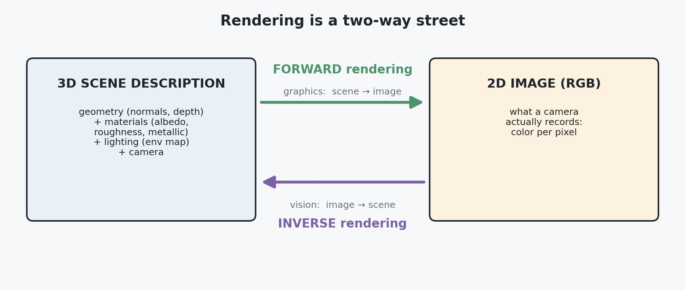
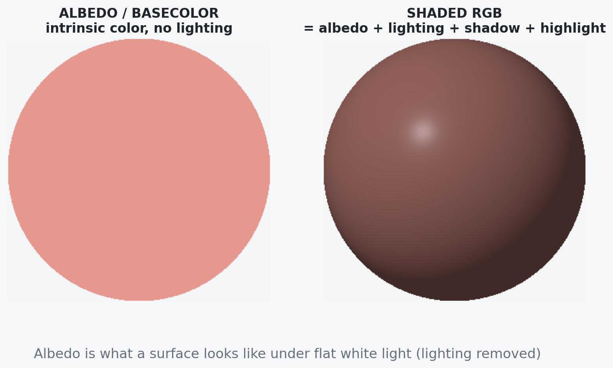
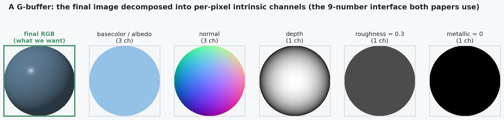
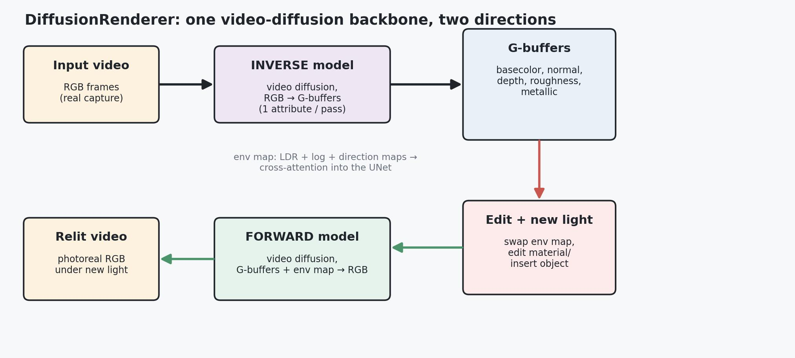

# Neural Rendering with Diffusion Models: a 3D primer for 2D people

This note has two jobs.

The **first and larger job** is a self-contained crash course in the 3D-graphics vocabulary that two recent neural-rendering papers assume you already know: *rendering, forward vs. inverse rendering, surface normals, depth, materials, the BRDF, albedo/basecolor, roughness, metallic, environment maps, HDR, irradiance,* and the umbrella term **G-buffer**. If you come from image processing, linear algebra, classical vision, and diffusion — but have never touched 3D — these terms are the wall you hit on page one. We will climb it slowly, intuition first.

The **second job** is to read the two papers with that vocabulary in hand:

1. **DiffusionRenderer** — *Neural Inverse and Forward Rendering with Video Diffusion Models* (NVIDIA, 2025). One video-diffusion backbone that goes *both* ways: image/video → scene properties (inverse), and scene properties + lighting → image/video (forward).
2. **FrameDiffuser** — *G-Buffer-Conditioned Diffusion for Neural Forward Frame Rendering* (2025). Forward rendering only, but **one frame at a time, autoregressively**, aimed at interactive/game use.

A useful one-line framing before we start: **classical rendering is a hand-written physics simulator that turns a 3D scene into an image; neural rendering replaces that simulator with a learned network** — and diffusion models turn out to be a very good learned renderer, because "produce a plausible image consistent with some conditioning" is exactly what they already do.

You are assumed fluent in diffusion (latent diffusion, the denoising UNet, VAEs, cross-attention, classifier-free guidance, LoRA, ControlNet). Those are referenced, not re-taught — see [ddpm_ddim_flow_score.md](./ddpm_ddim_flow_score.md) and [lora.md](./lora.md) if you want refreshers. The 3D half assumes none of it.

---

## Table of Contents

- [1. What "rendering" means: forward vs inverse](#1-what-rendering-means-forward-vs-inverse)
- [2. How a 3D scene is described](#2-how-a-3d-scene-is-described)
  - [2.1 Coordinate frames: world space and camera space](#21-coordinate-frames-world-space-and-camera-space)
  - [2.2 Geometry: meshes, triangles, surfaces](#22-geometry-meshes-triangles-surfaces)
  - [2.3 From scene to pixels: rasterization vs ray tracing](#23-from-scene-to-pixels-rasterization-vs-ray-tracing)
- [3. Surface normals: the most important 3D channel](#3-surface-normals-the-most-important-3d-channel)
  - [3.1 What a normal is](#31-what-a-normal-is)
  - [3.2 Why lighting depends on the normal](#32-why-lighting-depends-on-the-normal)
  - [3.3 Storing normals as an image](#33-storing-normals-as-an-image)
  - [3.4 Camera space vs world space normals](#34-camera-space-vs-world-space-normals)
- [4. Depth](#4-depth)
- [5. Materials and the BRDF](#5-materials-and-the-brdf)
  - [5.1 The rendering equation](#51-the-rendering-equation)
  - [5.2 Physically based rendering (PBR)](#52-physically-based-rendering-pbr)
  - [5.3 The metallic-roughness workflow](#53-the-metallic-roughness-workflow)
- [6. Albedo and basecolor](#6-albedo-and-basecolor)
- [7. Roughness and metallic](#7-roughness-and-metallic)
- [8. Why you cannot just add light to a G-buffer](#8-why-you-cannot-just-add-light-to-a-g-buffer)
- [9. Lighting as an image: environment maps, HDR, irradiance](#9-lighting-as-an-image-environment-maps-hdr-irradiance)
  - [9.1 From point lights to image-based lighting](#91-from-point-lights-to-image-based-lighting)
  - [9.2 Equirectangular panoramas and HDR](#92-equirectangular-panoramas-and-hdr)
  - [9.3 Radiance vs irradiance](#93-radiance-vs-irradiance)
- [10. The G-buffer: the interface both papers speak](#10-the-g-buffer-the-interface-both-papers-speak)
- [11. DiffusionRenderer: inverse and forward rendering with video diffusion](#11-diffusionrenderer-inverse-and-forward-rendering-with-video-diffusion)
  - [11.1 The problem it solves](#111-the-problem-it-solves)
  - [11.2 The inverse model: video to G-buffers](#112-the-inverse-model-video-to-g-buffers)
  - [11.3 The forward model: G-buffers plus light to video](#113-the-forward-model-g-buffers-plus-light-to-video)
  - [11.4 Representing the environment map](#114-representing-the-environment-map)
  - [11.5 Training data: synthetic plus auto-labeled real](#115-training-data-synthetic-plus-auto-labeled-real)
  - [11.6 Relighting, material edits, and object insertion](#116-relighting-material-edits-and-object-insertion)
  - [11.7 Results and limitations](#117-results-and-limitations)
- [12. FrameDiffuser: one frame at a time for interactive rendering](#12-framediffuser-one-frame-at-a-time-for-interactive-rendering)
  - [12.1 The problem it solves](#121-the-problem-it-solves)
  - [12.2 Architecture: ControlNet plus ControlLoRA](#122-architecture-controlnet-plus-controllora)
  - [12.3 The irradiance trick: lighting without a light](#123-the-irradiance-trick-lighting-without-a-light)
  - [12.4 Training in three stages](#124-training-in-three-stages)
  - [12.5 Results and limitations](#125-results-and-limitations)
- [13. DiffusionRenderer vs FrameDiffuser, side by side](#13-diffusionrenderer-vs-framediffuser-side-by-side)
- [14. A compact mental model](#14-a-compact-mental-model)
- [Sources](#sources)

---

## 1. What "rendering" means: forward vs inverse

**Rendering** is the process of turning a description of a 3D world into a 2D image — the thing a camera at some position would see. That description has four parts, and it is worth naming them now because *every* term in this note slots into one of them:

- **Geometry** — the shapes of surfaces in the scene (where they are, which way they face).
- **Materials** — what each surface is made of (its color, how shiny or rough it is, whether it is metal).
- **Lighting** — where light comes from and how bright it is.
- **Camera** — where you are looking from, and with what lens.

Feed all four into a physics simulation of how light travels, and out comes an image. That direction — **scene → image** — is **forward rendering**. It is what a game engine or a movie renderer does. It is a well-posed problem: given the full physical description, the image is essentially determined.

The reverse direction — **image → scene** — is **inverse rendering**. Given a photo, recover the geometry, materials, and lighting that produced it. This is what classical computer vision has always secretly wanted to do, and it is *much* harder, because it is badly **ill-posed**: many different scenes produce the same pixels. A gray pixel could be a white surface in shadow or a gray surface in bright light; a bright edge could be a painted stripe (a material) or a crease catching light (geometry). Disentangling "what is it made of" from "how is it lit" from a single image is genuinely ambiguous, which is exactly why a learned prior — a diffusion model that has seen millions of images and knows what surfaces and lighting usually look like — is so valuable here.

*Forward rendering (graphics) turns a full scene description into an image; inverse rendering (vision) tries to recover that description from the image. Both papers in this note live on these two arrows — DiffusionRenderer learns **both**, FrameDiffuser learns only the forward one.*

Keep this picture in your head: the two papers are, quite literally, learned versions of the two arrows above. Everything in the next nine sections is just *unpacking what lives inside the two boxes* — what the "scene description" actually contains, channel by channel.

---

## 2. How a 3D scene is described

### 2.1 Coordinate frames: world space and camera space

A point in 3D is just three numbers $(x, y, z)$ — a vector, exactly like the vectors you already know from linear algebra. The only new wrinkle is that the *same* physical point has different coordinates depending on which frame of reference you measure it in:

- **World space** — a fixed global frame for the whole scene. The origin is some agreed-upon spot; a chair is "over there," a lamp is "up there," regardless of where you stand.
- **Camera space** (a.k.a. view space) — the frame attached to the camera. The origin is the camera itself, one axis points where the camera looks, and coordinates are "relative to me, the viewer." Move the camera and every point's camera-space coordinates change, even though the scene did not move.

Converting between the two is a rigid transform — a rotation plus a translation, i.e. multiplying by a matrix and adding an offset — the same machinery as any change of basis. (If rotations and their pitfalls interest you, see [euler_vs_quaternions.md](./euler_vs_quaternions.md).) This distinction matters later because DiffusionRenderer stores its **normals in camera space**: it describes which way each surface faces *relative to the viewer*, not relative to the world. That choice is deliberate — it lets the network reason about a surface's orientation purely from the image, without needing to know the camera's absolute pose in the world.

### 2.2 Geometry: meshes, triangles, surfaces

How do you describe an arbitrary shape — a face, a car, a crumpled cloth — with numbers? The dominant answer in graphics is the **triangle mesh**: approximate every surface by a large collection of flat triangles stitched at shared corners (**vertices**). A smooth sphere becomes a faceted ball of thousands of tiny triangles; use enough of them and the eye cannot tell. Triangles win because they are the simplest flat patch (three points always lie in a plane) and GPUs are built to process billions of them per second.

For this note you do not need mesh mechanics. You need one idea: **the scene has surfaces, and at every visible surface point there are local physical properties** — which way it faces, how far it is, what it is made of. When we render, we ultimately only care about the *first surface each pixel sees*. That per-pixel "what is the nearest surface, and what is it like there" is precisely the information a G-buffer stores (Section 10). The mesh is one way to *produce* it; the papers largely bypass meshes and work with these per-pixel surface properties directly, as images.

### 2.3 From scene to pixels: rasterization vs ray tracing

There are two classic strategies for the forward arrow (scene → image), and it is worth a one-paragraph recap because the papers' whole motivation is "these are expensive/hard, let a network do it instead." **Rasterization** is *primitive-driven*: take each triangle, project it onto the image plane, and fill in the pixels it covers, keeping the nearest one per pixel. It is extremely fast (this is what real-time games use) but it does not naturally follow light as it bounces, so shadows and reflections need extra tricks bolted on. **Ray tracing / path tracing** is *pixel-driven*: shoot a ray from the camera through each pixel, find what it hits, then shoot *more* rays toward lights and in reflected directions, recursively, to simulate light bouncing around. It is far more physically accurate (and is how photorealistic film frames and the *training data* for these papers are made) but far slower.

This is already covered in depth in [gaussian-splatting.md](./gaussian-splatting.md#rasterization-vs-ray-tracing), including a diagram — read that section if you want the details. The single takeaway you need here: **producing a truly photorealistic image the classical way (path tracing) requires knowing the *exact* geometry, materials, and lighting and then paying a large compute bill to simulate light transport.** Both papers exist because that exactness and that bill are painful, and a diffusion model can shortcut them.

---

## 3. Surface normals: the most important 3D channel

You asked specifically about normals. Good — because if you learn only one 3D concept from this note, make it this one. Normals are the channel that carries "shape" into the lighting math.

### 3.1 What a normal is

At any point on a surface, the **normal** is the unit vector pointing straight out of the surface, perpendicular to it — the direction the surface "faces" at that spot. On the top of a table the normal points straight up; on a wall it points horizontally out of the wall; on a sphere it points radially outward, different at every point.

*The normal (red arrows) is the local "which way is out." A curved surface has a smoothly varying field of normals — one 3D unit vector per point — and that field is what a **normal map** stores.*

Formally it is a 3D unit vector $n = (n_x, n_y, n_z)$ with $\lVert n \rVert = 1$. "Unit" because we only care about *direction*, not length. That is the whole definition. The reason it deserves a section is not its definition but its role.

### 3.2 Why lighting depends on the normal

Here is the key physical fact: **how bright a surface looks depends on the angle between its normal and the direction the light comes from.** A patch facing the light head-on catches the most light per unit area; a patch turned away catches light at a grazing angle, spread thin, so it looks dimmer; a patch facing fully away catches none.

That "how much it faces the light" is exactly a **dot product**. Let $n$ be the surface normal and $l$ the unit vector pointing toward the light. The fraction of light the surface receives is

$$
\text{brightness} \;\propto\; \max(0,\ n \cdot l).
$$

Unpacking every piece: $n \cdot l = \cos\theta$, the cosine of the angle $\theta$ between "which way the surface faces" and "which way the light is." When the surface faces the light, $\theta = 0$, $\cos\theta = 1$, full brightness. At a grazing $90°$, $\cos\theta = 0$, no light. The $\max(0, \cdot)$ clamps the back side (where the dot product goes negative) to zero, because a surface cannot receive *negative* light — a surface facing away is simply dark, not anti-lit. This is **Lambert's cosine law**, and it is the simplest possible shading model (a perfectly matte surface). The middle panel above is literally $\max(0, n\cdot l)$ evaluated over a sphere.

Now the punchline: **the image intensity at a pixel is driven by the normal there.** That is why "what shape is this surface" reduces, for lighting purposes, to "what is the normal field." If you know the normals and the light, you can already predict a huge fraction of the shading. This is why normals are a first-class G-buffer channel, and why estimating them well is half the battle of inverse rendering.

### 3.3 Storing normals as an image

A normal is three numbers per surface point. If we have one normal per pixel, that is exactly a **three-channel image** — same shape as an RGB image. So we store it as one: pack $(n_x, n_y, n_z)$ into $(R, G, B)$.

The only subtlety is range. Normal components live in $[-1, 1]$ (they are cosines of a direction), but image channels are usually $[0, 1]$. So we remap $c = 0.5\,n + 0.5$: a component of $-1$ becomes $0$, $0$ becomes $0.5$, $+1$ becomes $1$. This is why **normal maps look pastel and mostly blue**: a surface roughly facing the camera has $n \approx (0, 0, 1)$, which maps to $(0.5, 0.5, 1.0)$ — a light periwinkle blue. The reddish/greenish tints show where the surface tilts left/right or up/down. The right-hand panel above is exactly this encoding. When a paper says it "predicts a normal map," it means a network outputs this blue-ish 3-channel image, and each pixel decodes back to a unit vector.

### 3.4 Camera space vs world space normals

One last detail that shows up in DiffusionRenderer. The normal vector's numbers depend on the frame you express it in (Section 2.1). **Camera-space normals** describe orientation relative to the viewer; **world-space normals** relative to the fixed scene. DiffusionRenderer uses camera-space normals ("relative to me") because those can be read straight off an image without knowing where the camera sits in the world — a much easier target for a network that only sees pixels. The trade-off: if you move the camera, the camera-space normals of a static wall change, so temporal consistency across a moving-camera video is something the model must learn to handle.

---

## 4. Depth

**Depth** is the second geometric channel, and it is the simplest: for each pixel, *how far away is the surface it sees?* Store one number per pixel and you get a **depth map** — a single-channel image where, by convention, nearer is brighter (or darker; conventions vary). The classic use inside a renderer is the **depth buffer** (or **z-buffer**): as rasterization draws triangles, it keeps, per pixel, the distance of the closest surface seen so far, so that a near object correctly hides a far one. That is the "keep the nearest visible surface" step from Section 2.3.

Two distinctions matter for the papers:

- **Metric vs relative depth.** *Metric* depth is in real units ("2.3 meters"). *Relative* depth only preserves ordering and rough proportions ("this is farther than that"), with the absolute scale unknown. Recovering true metric depth from a single image is impossible without extra cues (you cannot tell a real car from a perfect toy car from one photo), so learned methods usually predict **relative** depth. DiffusionRenderer predicts relative depth and normalizes it to the range $[-1, 1]$, which is a natural target range for a diffusion model that operates on normalized latents.

- **Why depth at all, if we have normals?** Normals tell you *orientation* but not *position*; depth pins down where the surface actually is along the camera ray. Together, normals + depth give a fairly complete local geometry: where each surface point is and which way it faces. That is enough to reason about occlusion, parallax, and — crucially for relighting — which surfaces can cast shadows on which others.

You will see depth as one of the channels in the G-buffer montage in Section 10.

---

## 5. Materials and the BRDF

Geometry (normals + depth) tells you *where* surfaces are and *how they face*. **Materials** tell you *what they do with light* — and that is what makes plastic look like plastic, gold look like gold, and skin look like skin, even at identical geometry.

### 5.1 The rendering equation

Everything in physically-based rendering is an approximation of one equation. Do not memorize it; read it once so the material terms below have a home. The light leaving a surface point toward the camera is

$$
L_o(\omega_o) \;=\; \int_{\Omega} f_r(\omega_i, \omega_o)\; L_i(\omega_i)\; (n \cdot \omega_i)\; d\omega_i .
$$

Unpacking each symbol, because this one equation *is* the subject of the whole materials/lighting discussion:

- $\omega_o$ is the **outgoing direction** — toward the camera. $L_o(\omega_o)$ is the outgoing **radiance**, essentially "how bright this point looks to the camera." That is what we want to compute for each pixel.
- $\omega_i$ is an **incoming light direction**. The integral $\int_\Omega \cdots d\omega_i$ sums over *all* directions in the hemisphere $\Omega$ above the surface — i.e. we gather light arriving from everywhere.
- $L_i(\omega_i)$ is the incoming radiance from direction $\omega_i$ — "how much light is coming from over there." This is the **lighting** part; an environment map (Section 9) is exactly a way to specify $L_i$ for every direction.
- $(n \cdot \omega_i)$ is our friend from Section 3.2 — Lambert's cosine, weighting each incoming direction by how head-on it hits the surface.
- $f_r(\omega_i, \omega_o)$ is the **BRDF** — the *Bidirectional Reflectance Distribution Function*. It is the material. It answers: "for light arriving from $\omega_i$, what fraction is reflected toward $\omega_o$?" A mirror's BRDF is a spike (light in equals light out, one direction only); matte paint's BRDF is nearly flat (light scatters equally everywhere); glossy plastic is in between.

So in words: **outgoing light = integrate, over all incoming directions, (material response) × (incoming light) × (cosine falloff).** The BRDF is the only material-specific piece. The materials half of a G-buffer — albedo, roughness, metallic — is just a compact set of knobs that *parameterize the BRDF* $f_r$.

### 5.2 Physically based rendering (PBR)

**PBR** (physically based rendering) is the modern convention of choosing BRDFs that obey real physics — energy conservation (a surface cannot reflect more light than it receives), plausible Fresnel behavior (everything gets more mirror-like at grazing angles), and so on — and, importantly, describing materials with a small set of **intuitive, artist-friendly parameters** that are reused across every game engine and renderer. The dominant PBR parameter set is the **metallic-roughness** model, popularized by Disney's "principled BRDF." It is exactly the set both papers use, which is not a coincidence: it is *the* industry standard, so training data and tools already speak it.

### 5.3 The metallic-roughness workflow

The metallic-roughness workflow describes almost any everyday surface with just a handful of per-pixel numbers:

- **basecolor / albedo** — 3 channels (RGB): the intrinsic color of the surface. (Section 6.)
- **roughness** — 1 channel: how rough vs. polished the microsurface is, controlling how sharp or blurry reflections are. (Section 7.)
- **metallic** — 1 channel: whether the surface behaves like a metal (conductor) or a non-metal (dielectric). (Section 7.)

That is $3 + 1 + 1 = 5$ material numbers per pixel. Add the geometry channels — normal (3) and depth (1) — and you get the **nine-number-per-pixel** description that *is* the G-buffer. Hold that "3 + 1 + 3 + 1 + 1 = 9" in mind; it is the exact interface FrameDiffuser conditions on, and (plus lighting) the interface DiffusionRenderer maps between.

The reason this tiny set is enough for photorealism is that a good microfacet BRDF (the Cook-Torrance / GGX family) takes these knobs and expands them into the full directional reflectance $f_r$. You do not need the formula, but the *shape* of it is worth one line: reflected light ≈ a **diffuse** term (matte, color from albedo) plus a **specular** term (the shiny highlight, its sharpness set by roughness, its color and strength set by metallic + Fresnel). The next two sections are just those knobs, one at a time.

---

## 6. Albedo and basecolor

This is the other term you asked about specifically, and it is the most important material channel — so we spend real time on it.

**Albedo** is the *intrinsic color* of a surface: the color it "really is," independent of how it happens to be lit. The cleanest mental definition:

> Albedo is what the surface would look like under perfectly flat, white, shadow-free light — with all shading, highlights, and shadows removed.

A red apple has red albedo whether it sits in noon sun, in candlelight, or in shadow. The *pixels* of a photo of that apple change enormously with lighting — bright on the sunlit side, dark in shadow, with a white specular dot where the sun reflects — but the albedo is the same red everywhere on the apple's skin. Albedo is the **lighting-invariant** part of appearance; the photo is albedo *entangled with* lighting and geometry.

*The same object. On the left, its albedo: flat intrinsic color, no cues about where the light is. On the right, the rendered RGB: the albedo modulated by Lambert shading (bright side / dark side), plus a specular highlight where the light reflects toward the camera. Inverse rendering is largely the art of getting from the right image back to the left one — pulling the lighting out.*

Why this matters so much for these papers: **relighting is trivial if you have albedo, and impossible if you don't.** To relight a scene — put the apple under new lighting — you need its lighting-*free* description first, then re-apply new light. That is the whole DiffusionRenderer relighting recipe: inverse-render to get albedo (and the other intrinsics), then forward-render with a new environment map. If you tried to relight the raw photo directly, the old shadows and highlights would still be baked in and would fight the new light. So albedo is the pivot channel that makes editing possible.

Now the term **"basecolor."** In the metallic-roughness workflow, "basecolor" is the name for this RGB channel, but it plays a *dual role* depending on the metallic value — and this dual role trips people up, so here it is explicitly:

- For a **non-metal** (dielectric, metallic $= 0$) — plastic, wood, skin, paint — basecolor is the **diffuse albedo**: the matte color that scatters in all directions. The specular highlight on a dielectric is essentially white/colorless (a shiny red plastic ball has a *white* hotspot), controlled separately.
- For a **metal** (conductor, metallic $= 1$) — gold, copper, steel — there is **no diffuse color at all**; metals reflect almost everything and absorb the rest immediately. Here basecolor instead tints the **specular reflection** — this is why gold reflections look gold and copper reflections look coppery. The "color" of a metal is the color of what it reflects, tinted by its basecolor.

So "basecolor" is a single storage slot whose physical meaning flips based on the metallic flag. That is exactly why metallic and basecolor are stored together and interpreted together, and why you cannot understand one without the other — which brings us to the next section.

---

## 7. Roughness and metallic

These are the two scalar knobs that, together with basecolor, cover most of the material world. The clearest way to feel them is to sweep both at once:

*Same geometry, same lighting, same basecolor — only roughness (left→right) and metallic (top→bottom) change. This one image is the entire intuition for both knobs.*

**Roughness** describes the *microscopic* bumpiness of the surface — far too small to see as geometry, but it governs reflections. The mental model is **microfacets**: imagine the surface as a carpet of countless tiny mirror facets. If they all point the same way (low roughness, a polished surface), the reflected light stays coherent and you get a **tight, sharp highlight** — a mirror is the extreme. If the facets point every which way (high roughness), each reflects light in a slightly different direction, so the highlight **spreads out into a broad, soft glow** and reflections get blurry. That is exactly the left-to-right progression in the grid: roughness $0.05$ gives a pinpoint highlight, roughness $0.8$ smears it across the whole sphere. Roughness is a single number in $[0, 1]$, and it is the knob artists reach for constantly (wet vs. dry, new vs. worn, polished vs. sandblasted).

**Metallic** is closer to a binary switch (though stored as $[0,1]$ to allow blends and partial coverage like dusty metal): is this a **conductor** (metal) or a **dielectric** (everything else — plastic, stone, wood, water, skin)? The physics differs sharply, as covered in Section 6:

- **metallic $= 0$ (dielectric):** a matte diffuse body colored by basecolor, plus a weak, *colorless* specular highlight. Top row of the grid: a clearly colored ball with a white hotspot.
- **metallic $= 1$ (metal):** essentially *no* diffuse body — the sphere's color comes entirely from reflection, tinted by basecolor. Bottom row: the body reads dark (because in this toy scene there is little around to reflect except the one light), with a strong tinted highlight. In a real scene with an environment map, that "dark" body would instead be filled with a colored reflection of the surroundings — which is precisely why metals need good lighting information to look right, a point FrameDiffuser has to work around.

Between them, **basecolor + roughness + metallic** is a remarkably complete language for surfaces, which is why it became the industry standard and why the datasets these papers train on are labeled in exactly these terms.

---

## 8. Why you cannot just add light to a G-buffer

A natural objection at this point: "If a pixel's color is BRDF × incoming light × cosine (Section 5.1), and I have all the material and geometry channels, isn't forward rendering just a per-pixel formula? Why train a giant diffusion model?"

Because the hard part of realism is **not local**. The rendering equation's $L_i(\omega_i)$ — the light arriving at a point — is not just "the lamp." It includes light that has **bounced off other surfaces** first. Real photorealism comes from effects that couple *different* parts of the scene together:

- **Cast shadows** — surface A blocks the light headed for surface B. To shade B you must know about A. A per-pixel formula that only sees B's own channels cannot know B is in shadow.
- **Inter-reflections / global illumination (GI)** — a red wall bleeds red light onto a nearby white floor; a bright window lights the whole room indirectly. Light bounces many times, and each bounce redistributes color and brightness across the scene.
- **Ambient occlusion (AO)** — creases and contact points (where a cup meets a table) receive less ambient light because nearby geometry blocks it, so they darken. This is a cheap, popular approximation of one part of GI, and you will sometimes see it as an extra G-buffer channel.
- **Reflections** — a mirror or glossy floor shows *other* objects, which requires knowing what is around, not just the local material.

Computing these correctly is exactly what path tracing does — by following light on its multi-bounce journey — and it is expensive precisely because it is global. This is the crux of why a learned renderer is attractive: a diffusion model trained on path-traced images can **learn to hallucinate physically plausible shadows, bounce light, and reflections directly from the G-buffer + lighting**, without simulating each bounce. It has effectively compressed "what light transport usually does" into network weights. So the G-buffer + light is the *input*, but turning it into a believable image still requires the global reasoning that the network supplies. That is the entire value proposition of both papers.

---

## 9. Lighting as an image: environment maps, HDR, irradiance

We have geometry and materials. The last ingredient is **lighting** — the $L_i$ term. How do you hand a renderer "the light in this scene"?

### 9.1 From point lights to image-based lighting

The simplest lights are analytic: a **point light** (a bulb at a location), a **directional light** (parallel rays, like the distant sun), an **area light** (a softbox). These are easy but look artificial in isolation, because real environments light objects from *every* direction at once — the sky, the ground, nearby walls, all contribute.

**Image-based lighting (IBL)** captures that richness by treating **the entire surrounding environment as the light source.** Instead of "a lamp at (x,y,z)," you provide a 360° image of all the light arriving at the scene from every direction. Drop an object in and it gets lit — and reflects — the whole surroundings. This is how you get an inserted CGI object to look like it belongs in a real photo, and it is exactly how DiffusionRenderer specifies lighting.

### 9.2 Equirectangular panoramas and HDR

How do you store "light from every direction" as a 2D image? With an **equirectangular panorama**: unwrap the full sphere of directions onto a rectangle, with longitude along the x-axis (a full 360° turn) and latitude along the y-axis (from straight up to straight down) — the same projection as a world map flattening the globe. Each pixel is the light coming from one direction. Such an environment image is often called an **environment map** or, when it stores real captured light, an **HDRI** (high-dynamic-range image).

*The environment map (top-left) is the light source: every pixel is one incoming direction. The sun in it is far brighter than the sky — the log-encoded view (top-right) exposes that hidden peak. Below, the same environment lights a matte object and a metal one differently: the matte one gets soft directional shading, the metal one shows a bright reflected sun.*

The **HDR** part is essential, and it connects to your image-processing background. Ordinary images are **LDR** (low dynamic range): 8 bits per channel, values clipped to $[0, 1]$ (or $0$–$255$). But real light has enormous range — the **sun is thousands of times brighter than a shaded wall**. If you store lighting in LDR, the sun clips to plain white, indistinguishable from a white sheet of paper, and your highlights and reflections come out dull and wrong. **HDR** keeps those true intensities (floating point, values far above $1$), so a mirror reflecting the sun gets a searingly bright hotspot exactly as it should. This is why DiffusionRenderer feeds its environment map to the network in **three complementary forms** (detailed in 11.4): a tonemapped LDR version (overall look), a **log-encoded** version (which compresses the huge range so the bright sun's structure is visible to the network — the top-right panel above), and a per-pixel **direction** map (so the network knows *which way* each bit of light comes from). Log-scaling to tame a multiplicative dynamic range should feel familiar from signal processing.

### 9.3 Radiance vs irradiance

Two words that look alike and get confused, but the distinction matters for FrameDiffuser:

- **Radiance** — light along *one specific direction*. "How bright is the light coming from *that* exact direction?" $L_i(\omega_i)$ in the rendering equation is a radiance. It is directional.
- **Irradiance** — the *total* light landing on a surface point, summed over all incoming directions (weighted by the cosine). "How much light, all told, is hitting this spot?" It is the integral of incoming radiance — a single number per point, not a direction.

Intuition: radiance is "how bright is that one streetlight I'm looking at"; irradiance is "how much light is falling on my desk in total." Irradiance is what mostly determines how bright a diffuse (matte) surface looks — recall Lambert only cares about total received light, not its exact directional makeup. This is the hook FrameDiffuser exploits: rather than feed the model a full environment map, it feeds a cheap per-pixel **irradiance-like** channel that says "this spot is brightly lit, that spot is in shadow," which is enough to place shadows and highlights consistently frame to frame. More in Section 12.3.

---

## 10. The G-buffer: the interface both papers speak

Now we can define the term the whole note has been circling. A **G-buffer** ("geometry buffer," sometimes "geometry/graphics buffer") is a stack of per-pixel images, each holding one intrinsic scene property at that pixel. It is the bundle of everything from Sections 3–7, laid out as aligned image channels:

*A G-buffer is the final image (far left) taken apart into its intrinsic channels. Reading right from the RGB: basecolor (albedo), normals (as the blue-ish RGB encoding), depth, roughness, and metallic. That is $3+3+1+1+1 = 9$ numbers per pixel — the exact quantity FrameDiffuser conditions on, and the quantity DiffusionRenderer estimates.*

The term comes from a real-time technique called **deferred shading**. Classic ("forward") shading computes lighting for every triangle as it is drawn, wasting work on pixels later hidden by nearer objects. Deferred shading splits rendering into two passes: first a **geometry pass** rasterizes the scene into the G-buffer (normal, depth, albedo, roughness, metallic per visible pixel — no lighting yet); then a **lighting pass** reads the G-buffer and computes shading once per final pixel. Decoupling geometry from lighting is efficient, and it produced a happy side effect the neural-rendering community seized on: **the G-buffer is a clean, standardized, image-shaped description of a scene's intrinsics, perfectly separated from lighting.**

That separation is *exactly* what both papers need, and it is why the G-buffer is the pivot of this entire note:

- **Inverse rendering = estimate the G-buffer from an image.** (DiffusionRenderer's decomposition model.)
- **Forward rendering = turn a G-buffer (+ lighting) into an image.** (Both papers' rendering models.)
- **Editing = modify the G-buffer, or swap the lighting, then re-render.** (Relighting, material edits, object insertion.)

With that, the vocabulary is complete. Everything the two papers do is now expressible as operations on G-buffers and environment maps. Onward to the papers.

---

## 11. DiffusionRenderer: inverse and forward rendering with video diffusion

*Paper 1 — Liang et al., NVIDIA, "DiffusionRenderer: Neural Inverse and Forward Rendering with Video Diffusion Models," 2025 ([arXiv:2501.18590](https://arxiv.org/abs/2501.18590)).*

### 11.1 The problem it solves

Classical physically-based rendering is accurate but **demands inputs you almost never have for a real scene**: exact 3D geometry, clean material maps, and a measured environment map. Capturing all of that from the real world is impractical. Meanwhile, classical inverse rendering (recovering those inputs from images) is brittle and ill-posed (Section 1). DiffusionRenderer's thesis is to do **both directions with one neural framework** built on a **video diffusion** prior, so that (a) the inverse direction can lean on a strong learned prior to resolve ambiguity, and (b) the forward direction can synthesize photorealistic images from *imperfect, estimated* G-buffers — tolerating exactly the errors that would break a physics simulator. The payoff is a practical pipeline for **relighting, material editing, and object insertion** on ordinary videos.

Why **video** diffusion rather than image diffusion? Two reasons. First, the targets are videos, and a video backbone (they build on **Stable Video Diffusion**) enforces **temporal consistency** — a relit clip should not flicker. Second, multiple frames give multiple views of the same surfaces, which genuinely helps disambiguate materials from lighting: the paper reports the video model cutting metallic error by ~41% and roughness by ~20% versus an image-only baseline, because seeing a highlight move as the view changes is a strong cue for "this is shiny," not "this is a painted bright spot."

*The full loop. Inverse model: RGB video → G-buffers. Then optionally edit the G-buffers or swap the environment map. Forward model: G-buffers + environment map → relit RGB video.*

### 11.2 The inverse model: video to G-buffers

The **inverse (decomposition) model** takes an RGB video and outputs the G-buffer channels — basecolor $a$, camera-space normal $n$, relative depth $d$, roughness $r$, metallic $m$. Mechanically it is a conditional video diffusion model: the input video is VAE-encoded into a latent $z$, that latent is concatenated with the noisy G-buffer latent, and the UNet denoises toward the clean G-buffer channel. Standard conditional-diffusion plumbing, which you already know.

The clever bit is that the five attributes are **generated in separate passes**, not all at once, and the model is told which attribute to produce via a small **learnable domain embedding** $c_{\text{emb}}$ injected through cross-attention — one code for "give me normals," another for "give me roughness," and so on. Sharing one backbone across attributes (rather than five separate networks) lets them share the heavy visual understanding while specializing the output head per attribute; it is a clean, parameter-efficient design.

### 11.3 The forward model: G-buffers plus light to video

The **forward (rendering) model** is the other arrow: given G-buffers and a target environment map, produce the RGB video. Each of the five G-buffer channels is VAE-encoded separately and the resulting latents are **concatenated** into one spatial conditioning tensor (the paper notes it stacks to 20 latent channels), which is then concatenated with the noisy RGB latent — so the geometry/material information enters the UNet spatially aligned with the image it is shading. The **lighting** enters differently, through cross-attention (next section), because lighting is a *global* property of the scene, not something tied to a particular pixel location — cross-attention is the natural way to let every pixel attend to the whole environment.

Crucially, this forward model **never runs a path tracer**. It has learned, from a huge corpus of path-traced training pairs, to produce the shadows, inter-reflections, and glossy reflections that Section 8 said require global reasoning — directly from the conditioning. That is the whole point: it is a learned stand-in for light transport.

### 11.4 Representing the environment map

Feeding an HDR environment map to a network needs care (Section 9.2), and DiffusionRenderer's encoding is a nice concrete example of the HDR issues we discussed. It converts the panorama into **three aligned 2D maps** and encodes them with a dedicated lighting encoder into multi-resolution features that are injected via cross-attention at several UNet levels:

- $E_{\text{ldr}}$ — a **tonemapped LDR** version (Reinhard tonemapping), giving the overall appearance in a friendly $[0,1]$ range.
- $E_{\text{log}}$ — a **log-encoded** version, $\log(E+1)$ normalized, which compresses the enormous HDR range so the network can actually *see* the structure of very bright sources like the sun (the top-right panel in the Section 9.2 figure).
- $E_{\text{dir}}$ — a per-pixel **direction** map (unit vectors), so the network knows which physical direction each environment pixel corresponds to.

Together these give the model both "how bright, across a huge range" (LDR + log) and "from which direction" (dir) — exactly the two things $L_i(\omega_i)$ needs.

### 11.5 Training data: synthetic plus auto-labeled real

You cannot get ground-truth G-buffers for real videos, so training data is the crux. DiffusionRenderer uses two sources:

- **Synthetic (perfect labels).** ~150,000 videos (24 frames, 512×512) path-traced with an OptiX renderer, using tens of thousands of 3D assets, thousands of PBR materials, and hundreds of HDR environment maps, with varied object/lighting motion. Here every G-buffer channel and the environment map are known exactly — ideal supervision, but with a **domain gap**: synthetic scenes do not look quite like real footage.
- **Real (auto-labeled).** To close the gap, they run their *own* trained inverse model on ~10,000 real videos (from DL3DV) to produce **pseudo-labels** for the G-buffers, and estimate environment maps with an off-the-shelf method (DiffusionLight). These labels are imperfect but plentiful, yielding ~150,000 real samples with usable supervision — a self-improving, bootstrap-style loop.

The forward model is then trained jointly on both, with **separate LoRA parameters** for the real (auto-labeled) samples so the model can absorb the real-domain look without letting the noisier real labels corrupt what it learned from clean synthetic data. (LoRA as a lightweight domain adapter — see [lora.md](./lora.md).)

### 11.6 Relighting, material edits, and object insertion

With both models trained, editing is the three-step **decompose → edit → recompose** loop from the figure:

1. **Inverse pass:** input video $\mathbf{I}$ → estimated G-buffers $\{\hat n, \hat d, \hat a, \hat r, \hat m\}$.
2. **Edit:** choose a new target environment map $E_{\text{tgt}}$ (relighting), and/or edit the G-buffers themselves — repaint basecolor, change roughness (material editing), or composite in a new object's G-buffers (object insertion).
3. **Forward pass:** $\{\hat n, \hat d, \hat a, \hat r, \hat m, E_{\text{tgt}}\}$ → the new RGB video.

Because step 1 stripped the lighting out into a G-buffer (recall Section 6: relighting is only possible once you have the lighting-free intrinsics), step 3 can honestly re-shade under the new light — casting new shadows, adding new reflections — rather than fighting the old baked-in lighting.

### 11.7 Results and limitations

It outperforms prior neural relighting/decomposition baselines (RGB↔X, DiLightNet, Neural Gaffer) on the usual image metrics (PSNR/SSIM/LPIPS) on synthetic scenes and objects, and generalizes from synthetic training to real videos, handling complex shadows and inter-reflections without any explicit path tracing. Reported numbers include ~26 dB PSNR for rendering on their synthetic-scenes benchmark (vs. ~20.7 for DiLightNet) and ~24.6 dB PSNR for relighting.

Limitations worth knowing: it is **offline** — roughly 20 denoising steps, on the order of ~20 s per 24-frame clip on an A100, so not interactive (the authors point to distillation as future work). Edited regions can drift slightly in color/texture, and real-world quality depends on the auto-labeling (especially the DiffusionLight environment-map estimates). And it needs the **whole clip at once** — which is precisely the gap the next paper attacks.

---

## 12. FrameDiffuser: one frame at a time for interactive rendering

*Paper 2 — "FrameDiffuser: G-Buffer-Conditioned Diffusion for Neural Forward Frame Rendering," 2025 ([arXiv:2512.16670](https://arxiv.org/abs/2512.16670)).*

### 12.1 The problem it solves

FrameDiffuser does **only forward rendering** (G-buffers → image), but under a constraint DiffusionRenderer cannot meet: **interactivity**. In a video game, each frame depends on live player input, so frames must be produced **causally, one at a time**, and cannot be known in advance. Existing neural renderers fail this in opposite ways:

- **Single-image models** (e.g. RGB↔X) render each frame independently, so they **flicker** — no temporal consistency between frames.
- **Video models** (DiffusionRenderer) enforce consistency but need the **entire sequence up front**, which is impossible when frame $t{+}1$ depends on what the player does after seeing frame $t$.

FrameDiffuser threads this needle with **autoregressive generation**: it produces frame $t$ conditioned on the current G-buffer *and on its own previously generated frame* $F_{t-1}$. That backward dependence is what buys temporal coherence without ever needing future frames — the same causal, one-step-at-a-time structure as autoregressive sequence models, applied to rendering.

*The autoregressive loop. G-buffer for frame $t$ enters via ControlNet; the previous generated frame $F_{t-1}$ (plus an irradiance channel) enters via ControlLoRA; the UNet denoises to frame $F_t$, which is then fed back as the "previous frame" for $t{+}1$.*

### 12.2 Architecture: ControlNet plus ControlLoRA

The backbone is plain **Stable Diffusion 1.5** (an image latent-diffusion model — no video model needed, since it works frame by frame). Two conditioning mechanisms are bolted on, each with a distinct job:

- **ControlNet — structural guidance from the G-buffer.** A trainable copy of the UNet encoder with zero-initialized connections (standard ControlNet) ingests a **10-channel** conditioning image: the nine standard G-buffer channels (basecolor 3, normal 3, depth 1, roughness 1, metallic 1) plus one extra irradiance channel (next section). This tells the model *what the scene geometry and materials are* at this frame — the spatial layout to render.
- **ControlLoRA — temporal coherence from the previous frame.** Low-rank adapters (rank-64; LoRA again, see [lora.md](./lora.md)) added throughout the UNet, driven by the **previous generated frame** $F_{t-1}$: that frame is VAE-encoded and **concatenated to the noisy latent** so the model can match its new output to what it just produced — keeping colors, textures, and lighting stable across frames.

Splitting the two conditionings is the key design choice: **ControlNet says "render *this* scene," ControlLoRA says "and keep it consistent with the last frame."** Inference is fast-ish for diffusion — ~10 denoising steps with a DPM-Solver — reaching roughly **1 FPS on an RTX 4090** (not yet real-time, but a different regime from DiffusionRenderer's per-clip offline inference).

### 12.3 The irradiance trick: lighting without a light

Here is FrameDiffuser's cleverest idea, and it ties directly back to Sections 8–9. DiffusionRenderer is *given* an environment map. A game engine's G-buffer, by contrast, does **not** include the final lighting — that is exactly the expensive global part the network is supposed to synthesize (Section 8). So where does FrameDiffuser get lighting cues?

It **derives an approximate irradiance channel from its own previous frame.** The previous *rendered* frame $F_{t-1}$ already has lighting baked into it (it was, after all, a fully shaded image). Dividing that shaded frame by the basecolor approximately **removes the material color and leaves the lighting** — literally inverting "pixel ≈ albedo × lighting" from Section 6. Concretely, in grayscale,

$$
I_{t-1}(x,y) \;=\; \frac{L\big(F_{t-1}(x,y)\big)}{L\big(C_{t-1}(x,y)\big) + \varepsilon},
$$

where $F_{t-1}$ is the previous output frame, $C_{t-1}$ is its basecolor, $L(\cdot)$ converts RGB to grayscale luminance, and $\varepsilon$ avoids dividing by zero (the result is clamped and normalized). This ratio is high where the surface was brightly lit and low where it was in shadow — an **irradiance-like** map (Section 9.3: total light received, not directional). Fed in as the 10th ControlNet channel, it gives the model "strong guidance about shadow and specular locations" so that lighting stays put frame to frame — **without any explicit light source, environment map, or ground-truth irradiance at inference.** The lighting information is bootstrapped from the model's own history. The trade-off is that lighting is *implicit and inherited* rather than controllable — you cannot cleanly relight a FrameDiffuser scene the way DiffusionRenderer can, because there is no environment map to swap.

### 12.4 Training in three stages

Autoregression has a notorious failure mode — **error accumulation**: the model trains on ground-truth previous frames but at inference consumes its *own* (slightly wrong) outputs, so small errors compound over hundreds of frames until the image drifts or degrades. FrameDiffuser's three-stage curriculum is built to prevent that:

1. **Stage 1 (structure only):** train the ControlNet on G-buffers alone, with a **black irradiance** channel and frozen base UNet. Learn the G-buffer → image mapping first, in isolation.
2. **Stage 2 (add temporal + lighting):** add ControlLoRA and the **real irradiance** channel, feeding ground-truth previous frames, with mild noise injection. Learn to use temporal context.
3. **Stage 3 (self-conditioning):** feed the model its **own generated frames** ~50% of the time, so training and inference finally match and the model learns to recover from its own mistakes. This closes the train/test gap that causes drift.

The paper reports this **self-conditioning + noise injection** is the single most important ingredient (roughly +48% PSNR over not using it), which is a nice general lesson about training any autoregressive generator. Training data is Unreal Engine 5 environments (Electric Dreams, City Sample, etc.), and — an important design stance — models are trained **per environment**: since a given game keeps one consistent art style and lighting behavior, specializing to it yields better consistency than one broadly general model.

### 12.5 Results and limitations

Against a naive single-image X→RGB baseline it is dramatically better (PSNR ~18.3 vs ~8.6, with correspondingly better SSIM/LPIPS), and — the headline — it stays **stable over thousands of frames** (demonstrated past 3000 frames), which is the whole point of the autoregressive machinery.

Limitations: models are **environment-specific** (no broad generalization — a deliberate trade for quality); residual **temporal flicker** remains, traced mainly to the VAE encode/decode; it under-renders **extreme darkness** (a bias toward lit regions); and with near-static cameras error can still slowly accumulate very late. And at ~1 FPS it is **not yet real-time**, though distillation and architectural cuts are the stated path there. The authors frame it explicitly as *augmenting* traditional rendering while preserving artist control over the G-buffers — the artist edits geometry/materials, the model supplies the lighting and shading.

---

## 13. DiffusionRenderer vs FrameDiffuser, side by side

Both condition a diffusion model on G-buffers, but they answer different questions. The contrast is the clearest way to lock in the whole note:

| Aspect | **DiffusionRenderer** | **FrameDiffuser** |
| --- | --- | --- |
| **Direction(s)** | Both **inverse** (video → G-buffers) and **forward** (G-buffers + light → video) | **Forward only** (G-buffers → frame) |
| **Temporal mode** | Whole clip at once (non-causal video model) | **Autoregressive**, one frame at a time (causal) |
| **Backbone** | Stable Video **Diffusion** (video) | Stable **Diffusion 1.5** (image) |
| **G-buffer conditioning** | Channels VAE-encoded, concatenated spatially with the noisy latent | 9 channels + irradiance → **ControlNet**; prev frame → **ControlLoRA** |
| **Lighting** | **Explicit** HDR environment map (LDR + log + direction), via cross-attention | **Implicit** irradiance derived from the model's *own previous frame*; no env map |
| **Relighting?** | **Yes** — swap the environment map and re-render | **No** — lighting is inherited, not controllable |
| **Generality** | One model, general across scenes; synthetic + auto-labeled real data | **Per-environment** models (specialized for one game's look) |
| **Speed** | Offline, ~20 s per 24-frame clip (A100) | ~1 FPS (RTX 4090); built toward interactivity |
| **Main use case** | Video relighting, material editing, object insertion | Interactive / game-style frame generation |

The essential trade-off: DiffusionRenderer is the **general, controllable, offline** tool — it *understands* the scene well enough to take it apart and relight it, at the cost of needing the whole clip and real time. FrameDiffuser gives that up for **causal, temporally-stable, per-scene** generation that could plausibly slot into an interactive loop — accepting fixed inherited lighting and per-environment training as the price of frame-by-frame operation.

---

## 14. A compact mental model

- **Rendering = scene ↔ image.** Forward (graphics) is scene → image; inverse (vision) is image → scene. Both papers are learned versions of these arrows.
- **A scene = geometry + materials + lighting + camera.** Everything else in the note is one of these four.
- **Geometry lives in two channels:** **normals** (which way each surface faces — the driver of shading, via $n\cdot l$) and **depth** (how far each surface is).
- **Materials live in three channels:** **basecolor/albedo** (intrinsic, lighting-free color — the pivot that makes relighting possible), **roughness** (sharp vs. blurry highlight), **metallic** (dielectric with matte body vs. metal that only reflects).
- **Those five, per pixel (3+1+3+1+1 = 9 numbers), are the G-buffer** — the standardized, lighting-free description both papers pivot on.
- **Lighting is a whole image** (an HDR environment map), and realism needs **HDR** because the sun is thousands of times brighter than the sky; the hard, *global* effects (shadows, bounce light, reflections) are exactly what a learned renderer supplies in place of path tracing.
- **DiffusionRenderer** learns both arrows with a video model and an explicit environment map → relighting and editing, offline.
- **FrameDiffuser** learns only the forward arrow, autoregressively, deriving lighting from its own previous frame → temporally stable interactive frames, per environment.

If you can explain that list to someone, you can hold your own on these papers in a room full of 3D people — which was the whole goal.

---

## Sources

- Liang et al., **DiffusionRenderer: Neural Inverse and Forward Rendering with Video Diffusion Models**, NVIDIA, 2025 — [arXiv:2501.18590](https://arxiv.org/abs/2501.18590) ([HTML](https://ar5iv.labs.arxiv.org/html/2501.18590)).
- **FrameDiffuser: G-Buffer-Conditioned Diffusion for Neural Forward Frame Rendering**, 2025 — [arXiv:2512.16670](https://arxiv.org/abs/2512.16670) ([HTML](https://ar5iv.labs.arxiv.org/html/2512.16670)).
- Background on rasterization vs. ray tracing, Structure from Motion, and scene representations: [gaussian-splatting.md](./gaussian-splatting.md).
- Diffusion, LoRA, and rotation background used above: [ddpm_ddim_flow_score.md](./ddpm_ddim_flow_score.md), [lora.md](./lora.md), [euler_vs_quaternions.md](./euler_vs_quaternions.md).
- Disney "principled BRDF" (Burley, 2012) and the Cook-Torrance/GGX microfacet model underlie the metallic-roughness workflow described in Sections 5–7.

*All figures in this note are original, generated by `scripts/diffusion_renderer_figs.py` (analytic shading, not copied from the papers).*
