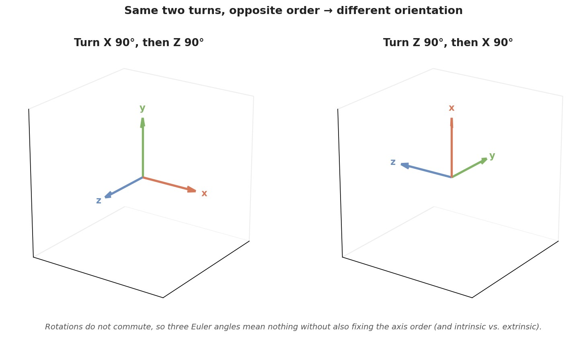
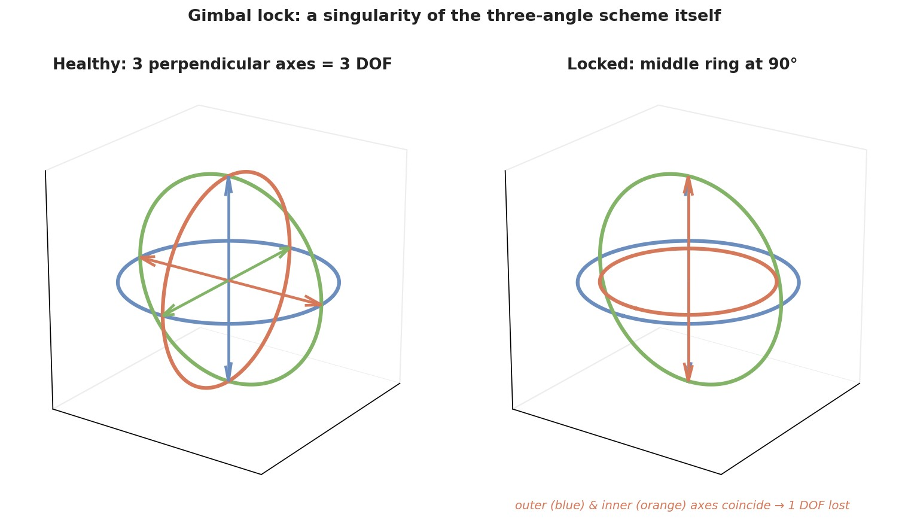
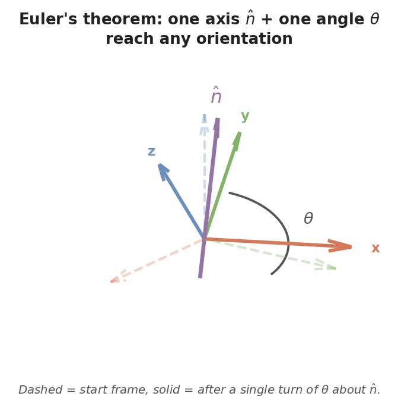
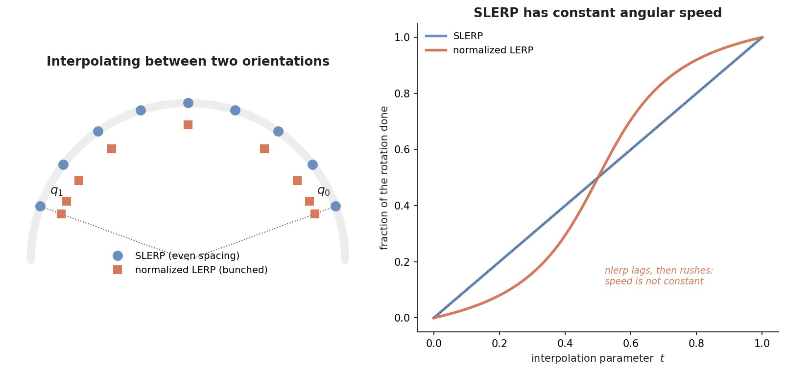
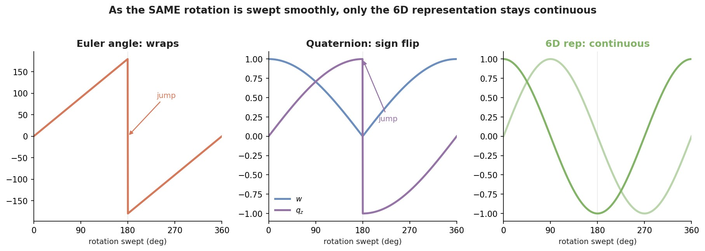

# Euler Angles vs. Quaternions (and the Other Ways to Store a Rotation)

If you have ever driven a rig in Blender or Unreal, you have met the pain first-hand: you type
three Euler angles, hand them to a friend, and their object ends up facing somewhere else. Or you
tilt a camera up 90° and suddenly two of your control axes do the same thing and one axis of
freedom just vanishes — **gimbal lock**. The usual advice is "switch to quaternions," and it
mostly works, but it rarely explains *what* was actually wrong or *why* the fix helps.

This note builds intuition for the handful of ways we store a 3D rotation and *why* we keep
several of them around instead of one. The cast:

* **Rotation matrices** — the unambiguous "ground truth," but bulky.
* **Euler angles** — three human-readable turns; the source of the convention mess and gimbal lock.
* **Axis–angle / rotation vectors** — one axis, one angle; minimal and intuitive.
* **Quaternions** — four numbers on a sphere; the engine workhorse, smooth to interpolate.
* **The 6D "continuous" representation** — a newer trick that fixes a problem the others all
  share, and which has quietly become standard when a *neural network* has to output a rotation.

The recurring theme is a single tension: a 3D rotation has only **three degrees of freedom**, yet
every way of writing it down either introduces a *singularity* (a place where the numbers misbehave)
or spends *extra numbers with constraints* to stay well-behaved. There is no free lunch — only
trade-offs — and knowing them tells you which representation to reach for.

---

## Table of Contents

- [Setup and Notation](#setup-and-notation)
- [Why representing a rotation is subtle](#why-representing-a-rotation-is-subtle)
- [Rotation matrices: the ground truth](#rotation-matrices-the-ground-truth)
- [Euler angles: three turns in a row](#euler-angles-three-turns-in-a-row)
  - [The convention trap: why the same three numbers give different rotations](#the-convention-trap-why-the-same-three-numbers-give-different-rotations)
  - [Gimbal lock: losing a degree of freedom](#gimbal-lock-losing-a-degree-of-freedom)
  - [Why Euler angles survive](#why-euler-angles-survive)
- [Axis-angle and the rotation vector](#axis-angle-and-the-rotation-vector)
- [Quaternions: the workhorse](#quaternions-the-workhorse)
  - [The unit-sphere picture](#the-unit-sphere-picture)
  - [Why quaternions dodge gimbal lock](#why-quaternions-dodge-gimbal-lock)
  - [The double cover: two quaternions per rotation](#the-double-cover-two-quaternions-per-rotation)
  - [SLERP: smooth interpolation](#slerp-smooth-interpolation)
  - [The costs of quaternions](#the-costs-of-quaternions)
- [Side-by-side comparison](#side-by-side-comparison)
- [Newer representations: continuity for neural networks](#newer-representations-continuity-for-neural-networks)
- [Which representation should I use?](#which-representation-should-i-use)
- [Takeaways](#takeaways)
- [Sources](#sources)

---

## Setup and Notation

A **rotation** here means a rigid turn about the origin — no stretching, no flipping. Concretely
it maps an object's local coordinate frame (its own $x$, $y$, $z$ arrows) onto a new orientation in
the world. All the representations below are just different *coordinates* for the same underlying
object.

| Symbol | Meaning |
| --- | --- |
| $R$ | a $3\times3$ **rotation matrix**; its columns are where the frame's $x,y,z$ axes point after the turn |
| $\mathrm{SO}(3)$ | the set of all valid 3D rotations (the "space of rotations" the representations try to describe) |
| $v,\ v'$ | a 3D vector before and after being rotated, $v' = R\,v$ |
| $(\alpha,\beta,\gamma)$ | three **Euler angles** (e.g. roll, pitch, yaw) |
| $\hat n$ | a **unit axis** (length 1) to rotate about |
| $\theta$ | the **angle** of rotation about that axis |
| $q=(w,x,y,z)$ | a **quaternion**: one real part $w$ and a 3D vector part $(x,y,z)$ |
| DOF | **degrees of freedom** — the number of independent knobs you can turn |

The single most important fact to hold onto: **a 3D rotation has exactly 3 DOF.** You can point the
"nose" of an object anywhere on a sphere (2 DOF) and then spin it about that nose direction (1 more)
— that is 3. Every representation is trying to cover those 3 DOF, and the trouble always comes from
*how* it packages them.

---

## Why representing a rotation is subtle

Here is the uncomfortable math fact underneath everything in this note. The space of rotations,
$\mathrm{SO}(3)$, is *curved* and *wraps around on itself* — spin 360° about any axis and you are
back exactly where you started. A flat list of three numbers (like Euler angles) is a flat sheet.
You cannot wrap a flat sheet smoothly around a closed, curved space without either **tearing it**
(a discontinuity — the numbers jump) or **creasing it** (a singularity — a spot where different
number-triples collapse to the same rotation and you lose control).

That is not a Blender bug or a floating-point quirk; it is a topological guarantee. So every scheme
picks its poison:

* **Minimal (3 numbers)** — Euler angles, rotation vectors. Matches the true 3 DOF exactly, but is
  *forced* to have singularities somewhere (gimbal lock, wraparound).
* **Redundant (4+ numbers with a constraint)** — quaternions (4 numbers, must have length 1),
  rotation matrices (9 numbers, must be orthonormal). Spending extra numbers buys smoothness and
  kills the singularity, at the cost of carrying a constraint you must keep satisfying.

Keep this "singularity vs. redundancy" fork in mind; it explains every trade-off that follows.

---

## Rotation matrices: the ground truth

The most literal way to store a rotation is to write down *where it sends the axes*. Stack the
new $x$, $y$, $z$ directions as the columns of a $3\times3$ matrix $R$. Rotating a vector is then
just $v' = R\,v$, and composing two rotations is a matrix multiply, $R_{\text{total}} = R_2 R_1$
(do $R_1$ first, then $R_2$). Clean and unambiguous.

The catch is that not every $3\times3$ matrix is a rotation. A valid rotation matrix must satisfy

$$
R^{\top} R = I, \qquad \det R = +1.
$$

Reading it: $R^{\top}R = I$ (the identity) says the columns are **orthonormal** — mutually
perpendicular unit vectors, i.e. the frame stays rigid (no stretch, no shear). $\det R = +1$ rules
out **reflections** (a mirror image has $\det = -1$), keeping it a pure rotation. Those two
conditions are exactly what "$\mathrm{SO}(3)$" means: *Special* ($\det = +1$) *Orthogonal* group in
*3* dimensions.

Count the freedom: 9 numbers, but the orthonormality conditions impose 6 independent constraints,
leaving $9 - 6 = 3$ DOF — the correct number, just wrapped in 6 redundant numbers. That redundancy
is the price for having **no singularities and no ambiguity**: every rotation is exactly one matrix.

The downsides are practical. Nine numbers is a lot to store and pass around. And you cannot
interpolate them naïvely — the average of two rotation matrices is generally *not* a rotation matrix
(it violates orthonormality), so blending two orientations by averaging entries gives garbage you'd
have to re-orthonormalize. Matrices are what GPUs ultimately consume to transform vertices, and what
we treat as "truth" when comparing representations — but they are rarely the thing you *author* or
*interpolate*.

---

## Euler angles: three turns in a row

Euler angles describe an orientation as **three simple turns applied in sequence**, each about a
coordinate axis — the intuitive "spin it a bit about $x$, then about $y$, then about $z$." This is
what Blender's rotation fields and most flight-sim "roll / pitch / yaw" controls expose, because it
maps directly onto how a human thinks about tilting something.

Written as matrices, a common convention (yaw–pitch–roll) is

$$
R = R_z(\gamma)\, R_y(\beta)\, R_x(\alpha),
$$

read right-to-left as: first roll by $\alpha$ about $x$, then pitch by $\beta$ about $y$, then yaw
by $\gamma$ about $z$. Three numbers, three DOF — beautifully minimal. And that minimality is
exactly where the trouble starts.

### The convention trap: why the same three numbers give different rotations

This is the "uniqueness issue" you remember. The three numbers are **meaningless on their own** —
they only define a rotation once you *also* fix a pile of conventions, and different tools pick
different defaults:

* **Axis order.** $R_z R_y R_x$ (a "ZYX" convention) is a *different* function of the angles than
  $R_x R_y R_z$. Because rotations don't commute, the order genuinely changes the result.
* **Intrinsic vs. extrinsic.** Do successive turns happen about the *world's* fixed axes
  (extrinsic) or about the object's *own* axes as they move with it (intrinsic)? Same angles,
  different outcome.
* **Units and sign.** Degrees vs. radians, and which spin direction counts as positive.

The figure below makes the non-commutativity concrete: the *same* two 90° turns, applied in the two
possible orders, land the frame in visibly different orientations.

So when you handed someone your three angles and they got a different rotation, nobody was wrong —
your Blender was likely using one convention (say intrinsic XYZ) and their tool another. The angles
were fine; the *decoder* differed. There are 12 valid axis-order conventions (XYZ, ZYX, ZXZ, …),
times intrinsic/extrinsic, times unit choices — plenty of room to disagree.

### Gimbal lock: losing a degree of freedom

The nastier problem is structural. Because the three turns are **nested**, the second turn can
swing the third axis directly on top of the first. When that happens, two of your three knobs now
rotate about the *same* axis — you have lost a whole degree of freedom and can no longer tilt in one
direction at all. That is **gimbal lock**.

Concretely, in a ZYX (yaw–pitch–roll) scheme, pitch the middle axis to $\beta = 90°$. Now the yaw
axis and the roll axis point the same way, so turning the yaw knob and turning the roll knob do the
*identical* thing. Three knobs, but only two distinct effects.

The physical version, on the left, is three nested rings ("gimbals"), each spinning about its own
axis — three perpendicular axes, three DOF. On the right, once the middle ring pitches 90°, the
inner ring's spin axis has swung onto the outer ring's axis. They are now parallel: rotating either
gives the same motion, and there is no ring left that tilts the object in the missing direction.

Two intuitions are worth nailing down, because they are widely garbled:

1. **It is a coordinate singularity, not a numerical glitch.** Near $\beta = 90°$ the mapping from
   angles to rotation becomes degenerate — many different $(\alpha,\gamma)$ pairs produce nearly the
   same orientation, so small orientation changes demand wild, near-infinite angle changes. It is the
   "crease" from the topology argument, landed at a specific pose.
2. **The lock belongs to the *three-sequential-angles scheme*, not to any one number format.** A
   common myth is that "quaternions have no gimbal lock" because quaternions are magic. The truer
   statement is that gimbal lock is what happens *when you insist on decomposing a rotation into
   three ordered turns*. If you convert a quaternion into Euler angles, the lock reappears in those
   angles. Quaternions dodge it only because they never decompose the rotation that way in the first
   place.

### Why Euler angles survive

Given all that, why does anyone still use them? Because for *humans* they are unbeatable: three
labeled dials (roll/pitch/yaw) are readable, editable, and keyframe-friendly. For authoring in a UI,
or for a gently-moving camera that never approaches the singular pose, Euler angles are perfectly
fine. The failure modes bite when orientations become arbitrary, get composed programmatically, or
sweep near the lock — which is precisely when engines convert them to something better internally.

---

## Axis-angle and the rotation vector

There is a beautifully minimal alternative, and it rests on **Euler's rotation theorem**: *any* 3D
orientation, no matter how tangled, can be reached by a **single** rotation of some angle $\theta$
about some **single** fixed axis $\hat n$. Not three turns — one.

So you can store a rotation as the pair $(\hat n, \theta)$: a unit axis and an angle. It is easy to
picture and it matches the true 3 DOF (2 for the axis direction, 1 for the angle). The recipe that
turns $(\hat n,\theta)$ back into a matrix is **Rodrigues' formula**,

$$
R = I + \sin\theta\, [\hat n]_\times + (1-\cos\theta)\, [\hat n]_\times^2,
$$

where $[\hat n]_\times$ is the "cross-product matrix" of $\hat n$ (the matrix that computes
$\hat n \times v$). You don't need to memorize it; the point is only that axis-angle converts cleanly
to the ground-truth matrix.

A tidy variant folds the two into a single 3-vector, the **rotation vector** $r = \theta\,\hat n$:
its *direction* is the axis and its *length* is the angle. This is the **exponential map** view —
$r$ lives in a flat 3D space and "exponentiates" onto the curved rotation space. It is the natural
place to represent *angular velocity* and to take derivatives, which is why robotics and
optimization love it.

The catches, again from the "minimal ⇒ singularity" rule: at $\theta = 0$ the axis $\hat n$ is
undefined (spinning by nothing — about *what* axis?), and the encoding wraps at $\theta = 2\pi$
(a full turn equals no turn), so the same rotation has many rotation-vector names as you add
multiples of $2\pi$. Axis-angle is also awkward to *compose* — chaining two of them means converting
out and back. It is a superb representation for a *single* rotation or a small increment, less so as
the thing you continuously accumulate. That last shortcoming is exactly what quaternions fix.

---

## Quaternions: the workhorse

Quaternions are what Unreal's `FQuat`, Unity, and virtually every physics and animation engine use
internally. A quaternion is four numbers — a real ("scalar") part $w$ and a 3D ("vector") part
$(x,y,z)$ — and for representing rotations we only ever use **unit** quaternions, those with

$$
w^2 + x^2 + y^2 + z^2 = 1.
$$

The magic is that a quaternion is essentially **axis-angle in disguise, repackaged so it composes
and interpolates cleanly.** The encoding is

$$
q = \left(\cos\tfrac{\theta}{2},\ \sin\tfrac{\theta}{2}\,\hat n\right),
$$

i.e. the scalar part records the (half) angle and the vector part points along the axis $\hat n$,
scaled by $\sin(\theta/2)$. So it stores the *same* $(\hat n, \theta)$ information as axis-angle, but
in a form where combining rotations is a single, well-behaved multiplication.

If you want just enough of the algebra to not treat it as a black box: quaternions extend complex
numbers with three "imaginary" units $i,j,k$ obeying $i^2=j^2=k^2=ijk=-1$, and $q = w + xi + yj +
zk$. Composing rotations is quaternion multiplication ("multiply the two $q$'s"); it is
non-commutative, mirroring the fact that rotations don't commute. To actually rotate a vector $v$
you write it as a pure quaternion $p=(0,v)$ and form the **sandwich product**

$$
p' = q\, p\, q^{-1},
$$

whose vector part is the rotated $v'$. Here $q^{-1}$ is the inverse (for a unit quaternion, just the
**conjugate** $(w,-x,-y,-z)$ — flip the vector part).

That sandwich, with $q$ on one side and $q^{-1}$ on the other, is the tidy intuition for the
otherwise-mysterious **half-angle**: the rotation gets applied *from both sides*, so each side must
carry only *half* the angle for the total to come out to $\theta$. Hold onto the half-angle — it is
the source of the one genuinely weird quaternion property, below.

### The unit-sphere picture

Since a unit quaternion satisfies $w^2+x^2+y^2+z^2=1$, every rotation is literally a **point on the
surface of a sphere in 4D** (a "hypersphere"). 3Blue1Brown's interactive explainer visualizes this
by stereographically projecting that 4D sphere into our 3D world; the takeaway you need is just the
mental model: *rotations are points on a smooth, closed, curved surface, and moving between
orientations means sliding along that surface.* There is no flat sheet to tear, which is precisely
why quaternions have no gimbal-lock crease.

### Why quaternions dodge gimbal lock

Because a quaternion encodes the **single** axis-angle turn (Euler's theorem), not a sequence of
three nested turns, there is no "middle ring" that can swing two axes into alignment. The
degenerate configuration that defines gimbal lock simply never arises — the representation doesn't
have three sequential gimbals to lock. (As noted earlier, if you *convert* a quaternion back into
three Euler angles, the lock returns in those angles; it was never the quaternion's fault, it is the
three-angle decomposition's fault.)

### The double cover: two quaternions per rotation

The half-angle has a surprising consequence: $q$ and $-q$ describe the **exact same rotation**.
Intuitively, spinning by $\theta$ about $\hat n$ and by $\theta - 2\pi$ about $\hat n$ land in the
same place, but the half-angle turns that $2\pi$ difference into a $\pi$ difference inside the
quaternion — which flips every sign. So the map from quaternions to rotations is **two-to-one**;
this is called the **double cover** of $\mathrm{SO}(3)$. (The famous "you must spin 720°, not 360°,
to return a quaternion to its original value" is the same fact seen from the other side.)

Two practical consequences:

* **Interpolation** must pick the *nearer* of the two twins. Before blending toward a target $q_1$,
  check the dot product $q_0 \cdot q_1$; if it is negative, flip $q_1$ to $-q_1$ so you take the
  short way around instead of the long 360°-ish detour.
* **Learning** is harder than it looks: a network told to regress a rotation as a quaternion has to
  somehow decide *which* of the two valid sign choices to emit, and that forced choice creates a
  discontinuity — foreshadowing the 6D fix below.

### SLERP: smooth interpolation

The single biggest reason engines love quaternions is buttery-smooth blending between orientations —
**SLERP**, Spherical Linear intERPolation. Because rotations are points on the 4D sphere, SLERP
walks along the *great-circle arc* between them at **constant angular speed**:

$$
\mathrm{slerp}(q_0, q_1; t) =
\frac{\sin\!\big((1-t)\,\Omega\big)}{\sin\Omega}\, q_0
+ \frac{\sin\!\big(t\,\Omega\big)}{\sin\Omega}\, q_1,
\qquad \cos\Omega = q_0 \cdot q_1 ,
$$

where $t$ runs from $0$ to $1$ and $\Omega$ is the angle between the two quaternions on the sphere.
Reading it: the two $\sin$ terms are just the weights that slide from all-$q_0$ to all-$q_1$ as $t$
grows, arranged so the result *stays on the sphere* and sweeps the angle $\Omega$ evenly.

The naïve alternative is to linearly blend the four numbers and re-normalize ("nlerp"). It's cheaper
and stays on the sphere, but it does *not* move at constant speed — it lags near the endpoints and
rushes through the middle, so a camera or joint eased between two poses would visibly speed up and
slow down. The figure contrasts them: evenly spaced SLERP samples vs. nlerp samples bunching toward
the ends.

### The costs of quaternions

Nothing is free. Quaternions are **not human-readable** — nobody eyeballs $(0.71, 0, 0.71, 0)$ and
sees "90° about $y$." They carry the length-1 **constraint**, so repeatedly composing them lets
floating-point error creep in and you must periodically **re-normalize** (divide by the length).
And the **double-cover** sign ambiguity has to be handled explicitly wherever you compare,
interpolate, or learn them. For a compact, singularity-free, smoothly-interpolable rotation to store
and compose, though, these are cheap prices — hence their dominance in engines.

---

## Side-by-side comparison

| Property | Rotation matrix | Euler angles | Axis-angle / rot. vector | Quaternion | 6D (continuous) |
| --- | --- | --- | --- | --- | --- |
| Numbers stored | 9 | 3 | 3–4 | 4 | 6 |
| Matches 3 DOF exactly? | No (6 redundant) | Yes | Yes | No (1 redundant) | No (3 redundant) |
| Unique per rotation? | Yes | No (convention + wrap) | No (wrap at $2\pi$) | No (double cover $\pm q$) | Yes (after fix-up) |
| Gimbal lock? | No | **Yes** | No | No | No |
| Easy to compose? | Yes (matmul) | No | No | Yes (quat mult) | No |
| Easy to interpolate? | No (breaks orthonormality) | No (jumps near lock) | Okay | **Yes (SLERP)** | Okay |
| Human-readable? | No | **Yes** | Somewhat | No | No |
| Continuous map from $\mathrm{SO}(3)$? | Yes | No | No | No | **Yes** |
| Typical use | GPU / ground truth | authoring, UI | angular velocity, robotics | engine internals, blending | neural-net **outputs** |

The last row is the practical summary; the last-but-one row ("continuous map") is the one that
motivates the newest representation, next.

---

## Newer representations: continuity for neural networks

You asked whether anything newer beats these — and there is a genuinely important one, especially in
an ML context. It comes from Zhou et al., *On the Continuity of Rotation Representations in Neural
Networks* (CVPR 2019), and it targets a problem *all* of the above share when a **neural network**
must *output* a rotation (pose estimation, human-motion models, 6-DOF object pose, etc.).

The problem is **discontinuity**, and it is the topology argument coming back to bite. A neural
network approximates a *continuous* function: nearby inputs should give nearby outputs. But as we
saw, any representation with 4 or fewer numbers *must* tear somewhere — Euler angles wrap, quaternion
signs flip at the double cover. So there exist orientations that are physically almost identical yet
whose *target numbers* sit far apart (or the reverse). The network is being asked to learn a function
with built-in jumps, and near those jumps it produces large, unavoidable errors. Zhou et al. proved
this is unavoidable for *every* representation of dimension $\le 4$ — quaternions and Euler angles
included.

The figure sweeps one rotation smoothly (a spin from 0° to 360°) and plots each representation's
numbers. The Euler angle **wraps** with a hard jump at 180°; the (sign-canonicalized) quaternion
**flips sign** at the double cover; only the **6D** representation varies as smooth sines and cosines
with no discontinuity at all.

Their fix is disarmingly simple. Represent a rotation by its **first two columns** — six numbers,
two 3D vectors $a_1, a_2$ — and rebuild a valid rotation matrix on the fly with **Gram–Schmidt**:

$$
b_1 = \frac{a_1}{\lVert a_1 \rVert}, \qquad
b_2 = \frac{a_2 - (b_1 \cdot a_2)\,b_1}{\lVert a_2 - (b_1 \cdot a_2)\,b_1 \rVert}, \qquad
b_3 = b_1 \times b_2 .
$$

Reading it: normalize the first vector to get column $b_1$; make the second vector perpendicular to
$b_1$ and normalize it to get $b_2$; and the third column $b_3$ is forced by the cross product (a
right-handed frame has no freedom left). The network can emit *any* six numbers and this procedure
always returns a valid, orthonormal rotation — and, crucially, the mapping is **continuous and onto
$\mathrm{SO}(3)$**, with no tear. (The third column is redundant, so we needn't store or predict it —
that is why 6, not 9.)

The payoff is empirical and consistent: networks using the 6D representation **converge faster** and
land **lower errors** (roughly 6–14% lower on pose-estimation benchmarks in their experiments) than
the same networks regressing quaternions or Euler angles. There is also a 5D representation with
similar properties, but 6D is the one that stuck; it is now a common default for rotation *outputs*
in modern pose and motion networks. (Note the scope: this matters when a *learned model produces*
rotations. For plain storage, compositing, and engine playback, quaternions remain the right tool —
6D doesn't replace them there.)

---

## Which representation should I use?

Match the tool to the job — that is why we keep all of them:

* **Authoring / UI / keyframes (Blender rotation fields, roll-pitch-yaw controls)** → **Euler
  angles.** Readable and editable. Just stay aware of the convention and avoid parking near gimbal
  lock.
* **Engine internal state, composing many rotations, blending between poses (Unreal `FQuat`,
  Unity `Quaternion`, skeletal animation)** → **quaternions.** Compact, no gimbal lock, and SLERP
  gives smooth motion. This is exactly the migration you made, and it was the right call.
* **Final vertex/GPU transforms, or "ground truth" for comparison** → **rotation matrices.** They're
  what the hardware consumes and the unambiguous reference everything converts to.
* **Angular velocity, integration, robotics/optimization** → **axis-angle / rotation vector
  (exponential map).** It lives in a flat space that's friendly to calculus.
* **A neural network that must *output* a rotation** → the **6D continuous representation**, converted
  to a matrix or quaternion afterward for use.

In practice a real pipeline uses several: author in Euler, store and blend in quaternions, hand
matrices to the GPU, and — if learning is involved — predict in 6D. None of them is "best"; each is
the least-bad packaging of those stubborn 3 degrees of freedom for a particular job.

---

## Takeaways

* A 3D rotation has **3 degrees of freedom**, but the space of rotations is *curved and closed*, so
  no representation can be simultaneously minimal, unique, and singularity-free. Every scheme trades
  a **singularity** (3-number formats) against **redundancy + a constraint** (4+-number formats).
* **Euler angles** are three sequential turns: readable, but meaningless without a fixed convention
  (the "same angles, different rotation" trap) and prone to **gimbal lock** — a coordinate
  singularity of the *three-angle scheme itself*, not of any number format.
* **Gimbal lock** is losing a DOF when nested turns align two axes. Quaternions avoid it not by
  magic but by never decomposing a rotation into three ordered turns.
* **Axis-angle / rotation vectors** capture Euler's theorem (one axis, one angle); minimal and great
  for angular velocity, but they wrap and don't compose nicely.
* **Quaternions** are axis-angle repackaged onto a 4D unit sphere: compact, no gimbal lock, and
  **SLERP** gives constant-speed blending. Costs: not readable, must stay normalized, and the
  **double cover** ($q \equiv -q$) needs handling.
* The newer **6D (Gram–Schmidt) representation** is *continuous*, which classic representations are
  not — a big deal specifically when a **neural network** must output rotations (faster convergence,
  lower error). Quaternions still win for storage, compositing, and engine playback.

---

## Sources

- Yi Zhou et al., [*On the Continuity of Rotation Representations in Neural Networks*](https://arxiv.org/abs/1812.07035) (CVPR 2019) — the 6D/5D continuous representations and why $\le 4$D reps are discontinuous.
- Grant Sanderson (3Blue1Brown) & Ben Eater, [*Visualizing quaternions, an explorable video series*](https://eater.net/quaternions) — the unit-hypersphere and stereographic-projection intuition.
- Omar Shehata, [*How to Fix Gimbal Lock in N-Dimensions*](https://omar-shehata.medium.com/how-to-fix-gimbal-lock-in-n-dimensions-f2f7baec2b5e) — the key clarification that gimbal lock belongs to the sequential-three-angle scheme, not to quaternions being magic.
- F. Sebastian Grassia, [*Practical Parameterization of Rotations Using the Exponential Map*](https://www.academia.edu/23711618/Practical_Parameterization_of_Rotations_Using_the_Exponential_Map) (JGT 1998) — axis-angle / rotation-vector and the exponential map.
- John D. Cook, [*Interpolating quaternion rotations with SLERP*](https://www.johndcook.com/blog/2023/03/15/slerp/) — SLERP, normalized-lerp drift, and the double-cover "nearest twin" trick.
- Andrea Pullia, [*Euler Angles, Gimbal Lock and Quaternions*](https://pulli.me/projects/gimbal_lock/) — a clear worked walkthrough of the Euler/gimbal/quaternion story.
