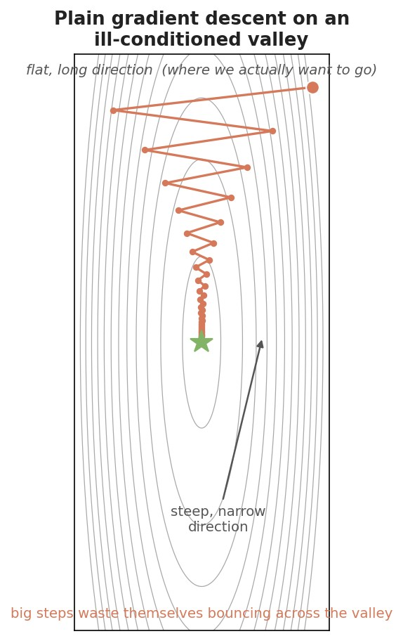
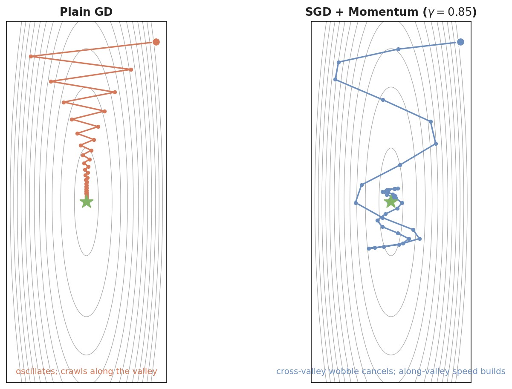
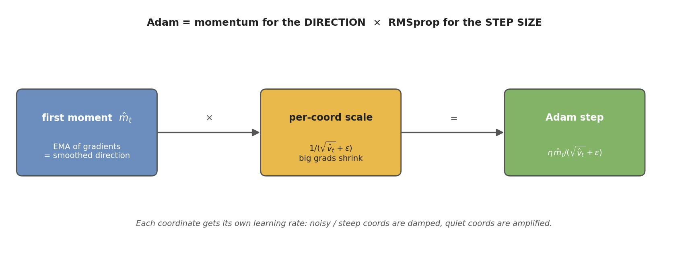
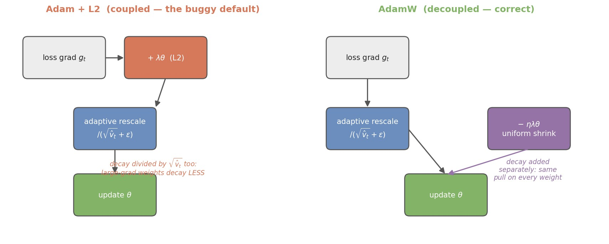

# Optimisers: SGD, Momentum, Adam, and AdamW

Training a neural network is, at bottom, a search. We have a loss $\mathcal{L}(\theta)$ — a single number measuring how wrong the network is — and a huge vector of parameters $\theta$ we are allowed to tweak. The optimiser is the rule that decides, at each step, *which direction to nudge $\theta$ and how far*. Everything else in deep learning (the architecture, the data, the loss) sets up the landscape; the optimiser is what actually walks down it.

Almost every optimiser in practice is a variation on one primitive move: **take a step downhill**, i.e. against the gradient $\nabla_\theta \mathcal{L}$. The whole story of this note is a sequence of fixes to that primitive, where each fix is motivated by a concrete way the previous one fails:

- **SGD** — take the downhill step, but estimate the gradient from a small random *mini-batch* instead of the whole dataset (because we cannot afford the whole dataset).
- **SGD + Momentum** — don't follow the noisy per-step gradient blindly; carry *inertia* so you accelerate along consistent directions and stop rattling across narrow valleys.
- **Adagrad → RMSprop** — give *each parameter its own learning rate*, scaled down where gradients are consistently large, so one badly-scaled coordinate can't dictate the global step size.
- **Adam** — combine those two ideas: momentum for the *direction*, per-parameter scaling for the *step size*. This is the workhorse.
- **AdamW** — fix a subtle but important bug in how Adam interacts with weight decay (L2 regularisation). This is the modern default for transformers and LLMs.

The goal is that by the end you see these not as five separate algorithms to memorise but as one idea with four patches bolted on, each patch fixing the last one's failure mode.

---

## Table of Contents

- [Setup and Notation](#setup-and-notation)
- [From full-batch GD to SGD](#from-full-batch-gd-to-sgd)
  - [The learning rate: the one knob you cannot ignore](#the-learning-rate-the-one-knob-you-cannot-ignore)
  - [Why noise is both a curse and a feature](#why-noise-is-both-a-curse-and-a-feature)
- [Why plain SGD struggles: ravines and ill-conditioning](#why-plain-sgd-struggles-ravines-and-ill-conditioning)
- [SGD + Momentum](#sgd--momentum)
  - [Nesterov: a look-ahead refinement](#nesterov-a-look-ahead-refinement)
- [Adaptive learning rates: Adagrad and RMSprop](#adaptive-learning-rates-adagrad-and-rmsprop)
- [Adam: momentum meets adaptivity](#adam-momentum-meets-adaptivity)
  - [Why bias correction](#why-bias-correction)
- [AdamW: decoupled weight decay](#adamw-decoupled-weight-decay)
- [Other optimisers, briefly](#other-optimisers-briefly)
- [Practical guidance: what to actually use](#practical-guidance-what-to-actually-use)
- [Learning-rate schedules: the optimiser's silent partner](#learning-rate-schedules-the-optimisers-silent-partner)
- [Takeaways](#takeaways)
- [Sources](#sources)

---

## Setup and Notation

A handful of symbols recur throughout. Each is reintroduced where it first does real work, but here they are in one place.

| Symbol | Meaning |
|---|---|
| $\theta$ | The parameter vector — all the weights and biases of the network stacked into one long vector. This is what we update. |
| $\mathcal{L}(\theta)$ | The loss: one scalar measuring how wrong the model is on the data. We want to minimise it. |
| $g_t = \nabla_\theta \mathcal{L}(\theta_t)$ | The **gradient** at step $t$ — the direction of *steepest increase* of the loss. We move against it. For SGD this is estimated on a mini-batch, so it is noisy. |
| $\eta$ | The **learning rate** (step size): how far we move along the chosen direction each step. |
| $t$ | The iteration (step) counter, $t = 1, 2, 3, \dots$ |
| $\gamma$ | The **momentum coefficient** ($0 \le \gamma < 1$, typically $0.9$): how much of the past velocity we keep. |
| $m_t$ | The **first moment** — an exponential moving average (EMA) of the gradient. The "momentum" / smoothed direction. |
| $v_t$ | The **second moment** — an EMA of the *squared* gradient. A per-parameter estimate of gradient magnitude. |
| $\beta_1, \beta_2$ | Decay rates for $m_t$ and $v_t$ in Adam (defaults $0.9$ and $0.999$). |
| $\epsilon$ | A tiny constant (e.g. $10^{-8}$) added to a denominator to avoid dividing by zero. |
| $\lambda$ | The **weight-decay** coefficient — how strongly we shrink weights toward zero (regularisation). |
| $\odot$, $\sqrt{\cdot}$ | Element-wise (per-coordinate) product and square root. Adam's operations are all element-wise. |

The one framing to keep in mind: we can never compute the *true* loss over the entire dataset cheaply, so we only ever get **noisy samples** of the gradient. Much of the design of good optimisers is really about *coping gracefully with that noise*.

---

## From full-batch GD to SGD

The textbook move is **gradient descent**: repeatedly step against the gradient of the loss.

$$
\theta_{t+1} = \theta_t - \eta \, g_t, \qquad g_t = \nabla_\theta \mathcal{L}(\theta_t).
$$

Reading it: $g_t$ points in the direction the loss increases fastest, so $-g_t$ points downhill; $\eta$ scales how big a stride we take; we land at $\theta_{t+1}$ and repeat. If the loss were a smooth bowl and $\eta$ were small enough, this provably crawls to the minimum.

The catch is the word "the loss." The true loss is an average over *every* training example:
$$
\mathcal{L}(\theta) = \frac{1}{N} \sum_{i=1}^{N} \ell(\theta; x_i, y_i),
$$
where $N$ is the dataset size and $\ell$ is the per-example loss. Computing $g_t$ exactly means a forward and backward pass over all $N$ examples *for a single parameter update*. With $N$ in the millions (or billions of tokens), that is one update per epoch — hopelessly slow.

The fix is **stochastic gradient descent (SGD)**: estimate the gradient from a small random **mini-batch** $B$ of examples instead of all $N$:
$$
g_t = \frac{1}{|B|} \sum_{i \in B} \nabla_\theta \, \ell(\theta_t; x_i, y_i).
$$
Because $B$ is a random sample, this is an *unbiased but noisy* estimate of the true gradient: on average it points the right way, but any single mini-batch gradient wobbles around the truth. The pure "one example at a time" version is the historical meaning of "stochastic"; in practice everyone uses mini-batches (say 32–4096 examples), which trade a little more compute per step for a much less jittery estimate. The names blur together — when people say "SGD" today they almost always mean mini-batch SGD.

Why is this a good trade? Two reasons. First, we get an update after every mini-batch instead of after the whole dataset, so we make thousands of times more progress per unit of compute. Second, the noise turns out to be useful — more on that below.

### The learning rate: the one knob you cannot ignore

The learning rate $\eta$ is the single most consequential hyperparameter. The intuition is a hiker taking steps downhill:

- **Too small** → each step barely moves; training is correct but glacially slow, and it can get stuck crawling in flat regions.
- **Too large** → steps overshoot the valley floor and can land *higher* than they started, so the loss oscillates or diverges to infinity.
- **Just right** → fast, steady descent.

There is no single correct $\eta$ for a whole run: early on you want big strides, later you want to settle into the minimum. That is why $\eta$ is almost always *scheduled* to change over training (see [Learning-rate schedules](#learning-rate-schedules-the-optimisers-silent-partner)).

### Why noise is both a curse and a feature

The mini-batch noise in SGD is a double-edged sword. The curse: the gradient jitters, so the path to the minimum is a drunken walk rather than a clean descent, and near the minimum SGD never fully settles — it bounces around in a small ball whose size is set by the noise and $\eta$.

The feature: that same jitter lets SGD **escape sharp, narrow minima and saddle points**. A tiny random kick can knock the iterate out of a sharp crevice, and empirically the *flat* minima SGD tends to settle into generalise better to unseen data than sharp ones. This is often called the *implicit regularisation* of SGD — the noise is doing something like regularisation for free. This is a big part of why plain SGD, despite being the simplest optimiser, still produces some of the best-generalising vision models.

---

## Why plain SGD struggles: ravines and ill-conditioning

Here is the geometric picture that motivates everything that follows. Real loss surfaces are rarely nice round bowls. Far more often they are **ravines**: long, narrow valleys that are very steep across the short axis and very gently sloped along the long axis. Formally the surface is **ill-conditioned** — the curvature is wildly different in different directions (the Hessian has a large ratio between its biggest and smallest eigenvalue).

Why is that a problem for plain SGD? SGD uses *one global learning rate* for all directions. That single $\eta$ has to satisfy two conflicting demands at once:

- Along the **steep** axis, even a modest step overshoots to the other wall of the valley. To stay stable, $\eta$ must be *small*.
- Along the **flat** axis — which is the direction we actually want to travel to reach the minimum — that same small $\eta$ makes almost no progress.

The result is the zig-zag below: SGD bounces back and forth across the steep walls while creeping agonisingly slowly toward the true minimum along the valley floor.

Every optimiser after this one is, in some sense, a way of fixing this exact picture. **Momentum** fixes it by averaging out the cross-valley oscillation while accumulating speed along the valley. **Adaptive methods** (Adagrad/RMSprop/Adam) fix it by giving the steep and flat directions *different* effective learning rates so no single global $\eta$ has to serve both.

---

## SGD + Momentum

The idea: instead of stepping along the raw gradient each time, maintain a running **velocity** — an exponential moving average of past gradients — and step along *that*. Physically, picture a heavy ball rolling downhill: it has inertia, so it doesn't instantly reverse direction when the local slope flickers; it keeps going where it has consistently been headed.

$$
v_t = \gamma \, v_{t-1} + g_t, \qquad \theta_{t+1} = \theta_t - \eta \, v_t.
$$

Term by term: $v_t$ is the velocity. Each step it *decays* the old velocity by $\gamma$ (keeping, say, 90% of it) and *adds* the current gradient $g_t$. Then we move along $v_t$ instead of $g_t$. When $\gamma = 0$ this collapses back to plain SGD; larger $\gamma$ means more memory of the past.

Why does this fix the ravine? Look at the two directions separately:

- **Across the valley** (the steep axis), the gradient flips sign every step — pointing at one wall, then the other. In the running average these opposite contributions **cancel**, so the velocity across the valley stays small. The oscillation is damped.
- **Along the valley** (the flat axis), the gradient always points the same way — slowly downhill. These aligned contributions **accumulate**, so the velocity in that direction *grows* step after step. Momentum builds up speed exactly where we want to go.

There is a clean way to see how much acceleration you get. If the gradient were roughly constant $g$ along the valley, the velocity converges to a geometric series $v_\infty = g(1 + \gamma + \gamma^2 + \cdots) = \dfrac{g}{1-\gamma}$. So the **effective step size** along a consistent direction is amplified by $\dfrac{1}{1-\gamma}$: with $\gamma = 0.9$ that is a $10\times$ boost. This is why momentum both converges faster *and* is more robust — you can often use a smaller base $\eta$ (safe across the steep direction) and still make fast progress along the valley.

Momentum is nearly free (one extra buffer $v_t$ the size of $\theta$) and helps almost always, so "SGD" in modern practice almost always means "SGD with momentum," typically $\gamma = 0.9$.

### Nesterov: a look-ahead refinement

**Nesterov Accelerated Gradient (NAG)** is a small tweak: instead of measuring the gradient at the *current* point $\theta_t$, measure it at where momentum is *about to carry you*, $\theta_t - \eta\gamma v_{t-1}$:
$$
v_t = \gamma \, v_{t-1} + \nabla_\theta \mathcal{L}\!\left(\theta_t - \eta\gamma v_{t-1}\right), \qquad \theta_{t+1} = \theta_t - \eta \, v_t.
$$
The intuition is a ball that can *see* it's about to overshoot and brakes early. Because the gradient is evaluated after the momentum jump, if that jump is about to send you up the far wall, the look-ahead gradient already points back and corrects it before you commit. In practice NAG gives a modest, reliable improvement over plain momentum and has stronger convergence guarantees on convex problems; it's a nice-to-have rather than a game-changer.

---

## Adaptive learning rates: Adagrad and RMSprop

Momentum fixes the ravine by smoothing the *direction*. The other family of fixes attacks the *step size* directly: give **each parameter its own learning rate**, so a steep coordinate can take small steps while a flat one takes big steps — no single global $\eta$ forced to serve both.

**Adagrad** does this by dividing each coordinate's step by the square root of the sum of its past squared gradients:
$$
G_t = G_{t-1} + g_t \odot g_t, \qquad \theta_{t+1} = \theta_t - \frac{\eta}{\sqrt{G_t} + \epsilon} \odot g_t.
$$
Here $G_t$ accumulates, per coordinate, how much gradient that coordinate has seen. A parameter with consistently large gradients builds up a large $G_t$ and so gets a *shrunk* effective learning rate; a rarely-updated parameter keeps a large one. This was a breakthrough for sparse problems (e.g. rare words in NLP), where you want big updates for features you seldom see.

But Adagrad has a fatal flaw for long training runs: $G_t$ **only ever grows**. Because it sums *all* past squared gradients forever, the denominator $\sqrt{G_t}$ marches to infinity, and the effective learning rate decays toward zero. Eventually the optimiser stops moving even though it hasn't converged.

**RMSprop** (Tieleman & Hinton, from a Coursera lecture — famously never formally published) fixes this with a one-line change: replace the ever-growing *sum* with an **exponential moving average** of squared gradients, so old gradients are gradually forgotten:
$$
v_t = \beta \, v_{t-1} + (1-\beta) \, g_t \odot g_t, \qquad \theta_{t+1} = \theta_t - \frac{\eta}{\sqrt{v_t} + \epsilon} \odot g_t.
$$
Now $v_t$ tracks the *recent* magnitude of each coordinate's gradient (with $\beta$ around $0.9$–$0.99$) rather than the all-time total, so the effective learning rate stays bounded and responsive. RMSprop is essentially "Adagrad that doesn't grind to a halt." It is also, as we're about to see, exactly one half of Adam.

---

## Adam: momentum meets adaptivity

At this point we have two independent good ideas:

- **Momentum** — an EMA of the gradient ($m_t$) for a smoothed *direction*.
- **RMSprop** — an EMA of the squared gradient ($v_t$) for a per-parameter *step size*.

**Adam** ("Adaptive Moment Estimation," Kingma & Ba 2015) is the natural marriage: keep both moving averages and use one for direction and the other for scaling.

$$
m_t = \beta_1 m_{t-1} + (1-\beta_1)\, g_t, \qquad v_t = \beta_2 v_{t-1} + (1-\beta_2)\, g_t \odot g_t.
$$

$m_t$ is the first moment (mean of recent gradients — the momentum term), and $v_t$ is the second moment (mean of recent squared gradients — the RMSprop term). The update rescales the momentum direction by the per-coordinate magnitude:

$$
\theta_{t+1} = \theta_t - \eta \, \frac{\hat m_t}{\sqrt{\hat v_t} + \epsilon},
$$

where $\hat m_t$ and $\hat v_t$ are the bias-corrected moments (defined below). Reading the fraction: the numerator $\hat m_t$ says *which way* to go (smoothed gradient); the denominator $\sqrt{\hat v_t}$ says *how big a step* per coordinate — large where that coordinate's gradients have been large, small where they've been small.

A useful way to read the ratio $\hat m_t / \sqrt{\hat v_t}$: it is roughly a **signal-to-noise ratio** per parameter. If a coordinate's gradient is consistent (mean $\hat m_t$ large relative to its spread $\sqrt{\hat v_t}$), Adam trusts it and takes a near-full step. If the gradient is just noise averaging to near zero, the ratio is small and Adam steps cautiously. In steady state the per-coordinate step is bounded by roughly $\eta$, which makes Adam remarkably insensitive to the raw scale of gradients — one reason it "just works" across wildly different architectures with little tuning.

### Why bias correction

There is one wrinkle. We initialise $m_0 = 0$ and $v_0 = 0$. Because these are EMAs starting from zero, in the early steps they are biased *toward zero* — they haven't had time to "warm up" to the true gradient magnitude. Concretely, after the first step $m_1 = (1-\beta_1) g_1$, which with $\beta_1 = 0.9$ is only $0.1\, g_1$ — a tenfold underestimate of the gradient.

If we used these raw, the step size $\hat m_t / \sqrt{\hat v_t}$ would be wrong early on (and in fact unstable, since $v_t$ is also underestimated under a square root). Adam corrects this analytically:
$$
\hat m_t = \frac{m_t}{1 - \beta_1^t}, \qquad \hat v_t = \frac{v_t}{1 - \beta_2^t}.
$$
The factor $1 - \beta_1^t$ is exactly the total weight the EMA has accumulated after $t$ steps; dividing by it rescales the estimate back to an unbiased one. Early on ($t$ small) $1-\beta_1^t$ is small, so it inflates the tiny raw moment up to the right size; as $t$ grows, $\beta_1^t \to 0$ and the correction fades to $1$ (no-op). It's a clean fix for a cold-start artifact. Defaults $\beta_1 = 0.9$, $\beta_2 = 0.999$, $\epsilon = 10^{-8}$ work across a huge range of problems.

---

## AdamW: decoupled weight decay

**Weight decay** is one of the oldest regularisers: gently pull every weight toward zero each step, which discourages large weights and improves generalisation. There are two ways people implement it, and for plain SGD they are *identical* — which is exactly the trap.

The first way is **L2 regularisation**: add $\tfrac{\lambda}{2}\|\theta\|^2$ to the loss. Its gradient is $\lambda\theta$, so it just adds a $\lambda\theta$ term to $g_t$. The second way is **decoupled weight decay**: skip the loss term and directly shrink the weights, $\theta \leftarrow \theta - \eta\lambda\theta$, as a separate step. For SGD, both amount to subtracting $\eta\lambda\theta$ — same thing.

For **Adam**, they are *not* the same, and this is the whole point. If you fold the decay into the gradient (the L2 way), that $\lambda\theta$ term flows through Adam's adaptive rescaling — it gets divided by $\sqrt{\hat v_t}$ along with everything else. The consequence is perverse: a weight with a **large, consistent gradient** (big $\hat v_t$) has its decay *divided down*, so it is regularised **less** — precisely the weights you'd most want to keep in check. Weight decay was supposed to be a *uniform* shrink applied equally to all weights, and coupling it to Adam's per-coordinate scaling destroys that uniformity.

**AdamW** (Loshchilov & Hutter, "Decoupled Weight Decay Regularization") fixes this by pulling the decay *out* of the adaptive machinery and applying it as its own clean step:
$$
\theta_{t+1} = \theta_t - \eta\left( \frac{\hat m_t}{\sqrt{\hat v_t} + \epsilon} + \lambda\,\theta_t \right).
$$
The first term is ordinary Adam; the second, $\eta\lambda\theta_t$, is a uniform pull toward zero that never touches $\sqrt{\hat v_t}$. Now every weight decays by the same relative amount regardless of its gradient history — weight decay does what it says again.

The payoff is both better generalisation *and* easier tuning: with the L2 version the effective regularisation strength was tangled up with $\eta$ (change one and you silently change the other), so you had to search a 2-D grid. Decoupling makes the optimal $\lambda$ roughly independent of $\eta$, turning one 2-D search into two cheaper 1-D searches. Because of all this, **AdamW is the default optimiser for training transformers and LLMs today** — if you reach for "Adam," you almost always want AdamW.

---

## Other optimisers, briefly

These are worth *recognising*; each can be expanded on request.

- **Nadam** — Adam with Nesterov-style look-ahead applied to the momentum term. A small, occasionally-helpful tweak; same spirit as NAG-vs-momentum.
- **AMSGrad** — patches a corner case where Adam can fail to converge on some convex problems, by forcing $\hat v_t$ to be non-decreasing (it keeps the running *max* of $v_t$). Theoretically tidy; in practice rarely moves the needle, so seldom used.
- **LAMB** — "Layer-wise Adaptive Moments." Adam plus a per-layer normalisation of the update, designed for **very large batch** training (it let BERT train with batch sizes in the tens of thousands). Reach for it only in the large-batch regime.
- **Newer optimisers (Lion, Shampoo, Muon, Sophia, …)** — an active research frontier. *Lion* (evolved-search-discovered) uses only the *sign* of a momentum term, is memory-light, and sometimes matches AdamW. *Shampoo* and *Muon* are "second-order-ish": they precondition using matrix (rather than per-coordinate) curvature information and have shown wins on large-scale training, at extra compute/memory cost. Promising but not yet the safe default — AdamW remains the thing to beat.

---

## Practical guidance: what to actually use

A rough decision guide, distilled from common practice:

| Situation | Sensible default | Why |
|---|---|---|
| Convolutional vision nets (ResNet, etc.) | **SGD + momentum** ($\gamma=0.9$) + a good LR schedule | Tends to *generalise* better than Adam here; the extra noise/flat-minima bias helps. Costs more tuning of $\eta$. |
| Transformers / LLMs / attention models | **AdamW** | Robust across scales with little tuning; handles the wildly-varying gradient magnitudes of attention and embeddings gracefully. The universal default. |
| Sparse features / recommenders | **Adagrad / Adam** | Per-parameter rates shine when different features are seen at very different frequencies. |
| Very large batch training | **LAMB** (or AdamW with warmup) | Keeps updates stable when the batch — and thus the effective step — is huge. |

Two rules of thumb that matter more than the exact optimiser choice: (1) **tune the learning rate first** — it dominates everything else; and (2) **use a schedule with warmup** for adaptive optimisers on transformers (below). Also note Adam/AdamW cost *two* extra buffers the size of $\theta$ ($m$ and $v$), i.e. ~2× the optimiser-state memory of momentum SGD — a real consideration at LLM scale, and part of why memory-saving variants exist.

---

## Learning-rate schedules: the optimiser's silent partner

No optimiser uses a truly constant $\eta$ in practice. Two schedule ingredients are near-universal, especially for AdamW on transformers:

- **Warmup** — start $\eta$ near zero and ramp it up linearly over the first few hundred/thousand steps. Early in training the moment estimates $m_t, v_t$ are unreliable (few samples), and a large step on a bad estimate can wreck the initialisation. Warmup lets the estimates stabilise before you trust them with big steps. This is why transformer training almost always diverges without warmup.
- **Decay** — after warmup, gradually lower $\eta$ toward zero, most commonly on a **cosine** curve. Big early steps explore; small late steps settle into the minimum instead of bouncing around it (recall SGD never fully settles at fixed $\eta$).

The optimiser decides the *direction and shape* of each step; the schedule decides its *overall magnitude over time*. They're complementary, and a great optimiser with a bad schedule will still train poorly — so treat the schedule as part of the optimiser choice, not an afterthought.

---

## Takeaways

- Every optimiser here is a patch on one primitive: **step against the gradient**. Learn them as a chain of fixes, not five separate recipes.
- **SGD** estimates the gradient on mini-batches — cheap, and its noise even helps generalisation by favouring flat minima. Its weakness is one global learning rate on ill-conditioned (ravine-shaped) surfaces.
- **Momentum** carries a velocity (EMA of gradients): it cancels cross-valley oscillation and accumulates speed along the valley, amplifying consistent directions by $\tfrac{1}{1-\gamma}$.
- **Adagrad → RMSprop** give each parameter its own step size from (an EMA of) squared gradients; RMSprop fixes Adagrad's learning rate decaying to zero.
- **Adam** = momentum (direction) × RMSprop (per-coordinate step size), plus **bias correction** to fix the cold-start of its zero-initialised moments. Robust and nearly tuning-free.
- **AdamW** decouples weight decay from the adaptive step, restoring uniform shrinkage and decoupling $\lambda$ from $\eta$. It is the default for transformers and LLMs.
- The **learning rate and its schedule** (warmup + cosine decay) matter as much as the optimiser choice — tune them first.

---

## Sources

- Sebastian Ruder, [An overview of gradient descent optimization algorithms](https://www.ruder.io/optimizing-gradient-descent/) — the canonical tour of SGD variants through Adam.
- Kingma & Ba, [Adam: A Method for Stochastic Optimization](https://arxiv.org/abs/1412.6980) (ICLR 2015).
- Loshchilov & Hutter, [Decoupled Weight Decay Regularization](https://arxiv.org/abs/1711.05101) (ICLR 2019) — the AdamW paper.
- Goh, [Why Momentum Really Works](https://distill.pub/2017/momentum/) (Distill) — the definitive interactive intuition for momentum and ill-conditioning.
- Duchi, Hazan & Singer, [Adaptive Subgradient Methods (Adagrad)](https://jmlr.org/papers/v12/duchi11a.html) (JMLR 2011).
- Tieleman & Hinton, RMSprop — Lecture 6e of the Coursera "Neural Networks for Machine Learning" course (unpublished; widely cited via slides).
- Reddi, Kale & Kumar, [On the Convergence of Adam and Beyond (AMSGrad)](https://arxiv.org/abs/1904.09237) (ICLR 2018).
- Chen et al., [Symbolic Discovery of Optimization Algorithms (Lion)](https://arxiv.org/abs/2302.06675) (2023).
